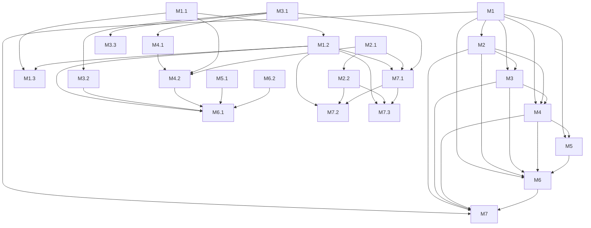

# 短视频下载器 规约 (v0.9.0)

> 业务层 → [prd.md](./prd.md)（本文件 Mx 模块与 prd 一一对应）

## 0. 元信息
- 状态：已确认（2026-10-29 架构讨论收敛，用户拍板重构）
- 日期：2026-10-29
- 决策人：bsawang
- 档位：完整档（模块边界变化）

## 1. 项目定位

页面附着的视频下载底座。通用能力（采集、交互、下载）与平台差异（规则、字段、锚点）分离；新增平台 = 新增一份适配 + 跑自检。

非目标见 §5。

## 2. 核心口径

### 2.1 中性数据契约

```ts
VideoItem = {
  videoId: string,            // 平台无关的唯一 id（抖音为 aweme_id，B站为当前分P的 cid）
  title: string,
  author: string,
  streams: Stream[],          // 按清晰度降序，至少 1 条
  pageKind?: 'card' | 'detail',
  fallback?: boolean,         // perf 兜底构造的条目（不进 store，仅本次渲染）
  [extra: string]: unknown    // 平台附加字段（如 B站 bvid/cid/page/pageCount/part），kernel 不读
}
Stream = { label: string, url?: string, qn?: number, kind?: 'video' | 'audio' }
// label 如 "1080p" / "1080P"；url 为带签名的直链，能预取到时才填；
// B站长视频直链会过期，只记平台档位码 qn，点下载时由 adapter.resolveDownload 现取；
// kind 标记 DASH 分离流（画面/音频各一条），缺省为可直接播放的单文件流
DownloadPlan = { url: string, credentials: 'omit' | 'include', headers?: Record<string,string>, filename?: string }
```

### 2.2 平台适配契约

```ts
PlatformAdapter = {
  id: string,
  matches: string[],                       // content-script 匹配模式
  sources: Source[],                       // 采集源，见 M1.2
  domSources?: DomSource[],                // DOM 采集源（接口数据被归一到组件树后的兜底），见 M1.2
  ssrSelector: string | null,              // 无 SSR 采集源时为 null
  perfPattern: RegExp | null,              // 无性能兜底源时为 null
  refresh?: (store: Store) => Promise<void>, // 平台数据需现取时由 adapter 自己拉，见 M1.2
  parse(raw: object): VideoItem | null,    // 平台原始条目 → 中性条目
  normalizeStreams(raw: object): Stream[], // 平台清晰度 → 中性流
  resolveDownload(item: VideoItem, stream: Stream): DownloadPlan | Promise<DownloadPlan>, // 允许异步现取直链
  filename?(item: VideoItem, stream: Stream): string, // 平台自定义文件名（B站含分P），缺省用 kernel 规则
  streamToDisk?: boolean,                  // 长视频落盘：true 时走 File System Access，见 M2.2
  anchors: AnchorRule[]                    // 见 M3.1
}
Source = { id: string, priority: number, reachableInPage: boolean,
           match(url: string): boolean, extract(text: string): object[] }
DomSource = { id: string, scan(root: Document): VideoItem[] }
AnchorRule = { selector: string, kind: 'card' | 'detail', mount: string[],   // 'self' | CSS 选择器，按序回退
               idFrom: { type: 'attr' | 'idPrefix' | 'className' | 'mediaSrc' | 'innerHref', ... }
                       | ((el: Element) => string | null),                  // 函数形式：DOM 无 id 信号时由平台自行取
               pageScope?: RegExp, resolve?(el: Element): Element }
```

### 2.3 硬边界

1. `src/kernel/**` 内不得出现平台字符串（域名、字段名、selector、清晰度命名）。
2. `src/platforms/**` 不得调用宿主 API（`chrome.*`、`GM_*`、`unsafeWindow`）。
3. 只有 `src/entry/**` 可以接触宿主环境。
4. 阶段 0 行为与 v0.5.3 等价：同一页面按钮数、清晰度档位、下载文件名规则不变。

## 3. 架构概览

### 3.1 技术底座
- 运行时：浏览器页面上下文（Tampermonkey 5.3+，`@grant none`；Chrome/Edge 138+ 需开启“允许用户脚本”）。
- 源码：ESM JavaScript（无 TypeScript），**零第三方运行时依赖**。
- 构建/测试：Node.js 24.15.0，`node --test`，自研 30 行拼接构建器。
- 目标浏览器：Chrome/Edge 111+（页面 API 实际要求），TM 侧按 5.3+。

### 3.2 目录与模块边界

```
src/kernel/extract.js      纯函数：deepFind / parseLooseJSON / normalizeQuality / sortStreams / sanitizeName
src/kernel/store.js        候选仓库：upsert / merge / get
src/kernel/hook.js         多源采集调度（fetch/XHR/SSR/DOM/perf）
src/kernel/mount.js        规则驱动扫描 + 挂载
src/kernel/ui.js           hover / popover / toast
src/kernel/download.js     DownloadPlan → blob transport / File System Access 落盘
src/kernel/core.js         组装 kernel，暴露 start(adapter)
src/platforms/douyin/rules.js    抖音全部常量与规则
src/platforms/douyin/adapter.js  parse / normalizeStreams / resolveDownload
src/platforms/bilibili/rules.js     B站全部常量、页面状态读取、锚点规则
src/platforms/bilibili/adapter.js   清晰度现取 / 直链解析 / 文件名 / refresh
src/entry/tm.js            按 URL 选 adapter 并调 start(adapter)
tools/build.mjs            ESM 拼接为单文件 user.js（合并各 adapter 的 @match）
tools/probe.mjs            CDP 四指标（阶段 0 仅骨架）
tests/*.test.mjs           node --test
tests/fixtures/*           样本与 legacy oracle
dist/douyin.user.js        构建产物
extension/                 冻结，仅回归沙箱
```

### 3.3 存储与通信
- 无持久化存储；候选仅内存 `Map<videoId, VideoItem>`。
- 单一页面上下文，kernel 内部为直接函数调用（不再需要跨世界 `postMessage`）。
- 采集中间态通过 `store.upsert` 汇合，UI 通过订阅回调刷新。

### 3.4 部署与运行
- `node tools/build.mjs` → `dist/douyin.user.js`（单文件，含 TM 元数据头）。
- 分发：TM 安装该文件；`@updateURL`/`@downloadURL` 指向 Releases 固定别名 `https://github.com/bsawang/video-downloader/releases/latest/download/douyin.user.js`，发版只需在新 release 挂同名资产。
- 回归沙箱：`extension/` 保留，用 `spikes/run.py --mode plugin` 对照旧行为。

### 3.5 约定
- ESM：每个模块只做命名导出，构建器剥离 `import`/`export` 后按固定拓扑序拼接。
- 命名：kernel 内函数不与平台词汇混用；平台词汇只允许出现在 `src/platforms/**`。因构建产物是单一作用域，各平台模块的顶层函数名必须全局唯一（B站侧统一 `bili` 前缀）。
- 日志：kernel 用 `log(level, ...)` 包装 `console`，默认 `warn` 以上输出；调试开关 `globalThis.__DL_DEBUG`。
- 测试组织：`tests/<module>.test.mjs`，fixture 放 `tests/fixtures/`。

### 3.6 选型记录
| 选什么 | 理由 | 被否决的替代方案 |
|---|---|---|
| 单一实施形态：TM 脚本 | 加平台只改 `@match`；`@updateURL` 自动更新；无需签名打包 | MV3 扩展（更新需重装）；TM + 扩展双产物（并行维护，已由用户否决） |
| ESM + 自研拼接构建 | 规模 <1500 行，零依赖，输出可读 | esbuild / rollup（引入构建依赖，收益低） |
| `@grant none` 单世界 | 页面上下文可直接 hook fetch/XHR，与现有能力等价 | `@grant GM_download` 沙箱世界（hook 需 unsafeWindow/注入，未验证）；双脚本 postMessage（分发变复杂） |
| 阶段 0 保留 blob 下载 | 行为等价，零风险 | 立即切 `GM_download`（阶段 0 无 GM API，且属功能变更） |
| 声明式锚点规则 | 规则是平台数据，扫描器可复用 | 通用 DOM 匹配器（平台差异无法稳定覆盖） |
| 验证通道：CDP（Node 内置 WebSocket，`tools/probe.mjs`） | 与用户实际调试方式一致，可复用已登录的本机 Chrome；注入 + 读 `__dlStats` 同一通道完成 | Playwright（另起 profile → 登录态失效、与用户 9222 端口冲突、匿名 headless 被判验证码；`spikes/verify_tm.py`、`spikes/verify_dom.py` 为历史脚本，默认不再使用） |
| 更新源：Releases 固定别名 `releases/latest/download/douyin.user.js` | 换版本只重发同名资产，脚本头的 URL 恒定；`dist/` 继续忽略，产物不进 git 历史 | `raw.githubusercontent.com` 直链（须把构建产物提交入库，与 `dist/` 忽略规则冲突，且每次发版产生二进制 diff）；`gh-pages` 分支（多一条发布链路，收益低） |
| B站清晰度用旧版 `playurl`（`fnval=1` → 单文件 `durl`），单文件拿不到的高档位另取 DASH 拆成「画面/音频」两条 | 低档直接得到可播放单文件；`accept_quality/accept_description` 只列当前账号在该视频上真实可取的档位；高档位先以分流提供，避免引入合流依赖 | 只用 DASH 一步到位（音视频分离，必须合流；合流见待定项 #3）；`__playinfo__` 首屏 SSR：切 P 后不更新，且档位受登录态限制不如接口真实 |
| B站长视频落盘走 File System Access（`showSaveFilePicker` + `createWritable`） | 3GB+ 单文件流式写盘，不整份驻留内存；picker 在点击的同步激活里弹出 | `GM_download`（需改 `@grant`/双世界，与 `@grant none` 单世界选型冲突，且 TM 下载器另起请求拿不到登录态）；继续用 blob（4 小时视频实测 3,482,563,020 B，内存扛不住） |

## 4. 功能需求

**子需求状态索引（progress 独占更新，spec 只填初始全 ⬜）：**
| 编号 | 模块 | 子需求 | 状态 |
|---|---|---|---|
| M1.1 | M1 | 通用递归提取与宽松解析 | 🟢 |
| M1.2 | M1 | 多源采集调度 | 🟢 |
| M1.3 | M1 | 候选去重与合并 | 🟢 |
| M2.1 | M2 | 清晰度标准化 | 🟢 |
| M2.2 | M2 | 下载计划与执行 | 🟢 |
| M3.1 | M3 | 规则驱动锚点扫描与挂载 | 🟢 |
| M3.2 | M3 | 按钮/菜单/toast 交互 | 🟢 |
| M3.3 | M3 | 详情弹层「作者作品」列表锚点与 fiber 数据源 | 🟢 |
| M4.1 | M4 | 抖音规则表 | 🟢 |
| M4.2 | M4 | 抖音适配钩子 | 🟢 |
| M5.1 | M5 | probe 四指标 | 🟢 |
| M6.1 | M6 | 构建与组装 | 🟢 |
| M6.2 | M6 | 行为基准 | 🟢 |
| M7.1 | M7 | B站详情页识别与清晰度 | 🟢 |
| M7.2 | M7 | 多分P切换与长视频落盘 | 🟢 |
| M7.3 | M7 | DASH 高档位分离流下载 | 🟢 |

### 需求树（依赖图）



### M1 视频识别与数据采集 🟢
模块概要：
- 职责：把页面自身数据流中的视频条目转成中性 `VideoItem` 并汇总
- 输入：页面网络响应体 / SSR 脚本 / performance 资源
- 输出：`store` 中的 `Map<videoId, VideoItem>`
- 依赖：无
- 被谁依赖：M2、M3、M4、M5、M6

#### M1.1 通用递归提取与宽松解析 🟢
- **验收**：`node --test tests/extract.test.mjs` 全绿；对含嵌套 `aweme_detail`、JSONL 流式帧、整体 JSON 三类 fixture，`parseLooseJSON` + `deepFind` 均产出预期条目
- **依赖**：无

详细设计：
- 数据流：`text → parseLooseJSON(text) → 依次 deepFind(obj, predicate) → rawItems[]`
- 接口：`parseLooseJSON(text): object[]`（逐行 `JSON.parse`，保留可解析对象；整体 JSON 额外尝试一次）；`deepFind(root, predicate, maxDepth=40): object[]`（深度优先，命中即收集且不再下钻命中节点）；`collect(text, source, adapter): VideoItem[]`（源提取 → 谓词命中 → `adapter.parse` → 按 `videoId` 去重）
- 数据结构：输出平台原始对象，不做字段映射
- 算法与规则：先逐行解析（流式帧/JSONL），再对全文整体解析；`seen` 以对象引用去重；深度上限 40 防环
- 错误与边界：解析异常静默跳过；`text` 非字符串返回 `[]`；空对象返回 `[]`
- 测试要点：M6.2 基准 1

#### M1.2 多源采集调度 🟢
- **验收**：详情页 fixture 下，hook 捕获的条目进入 store；`performance` 兜底源在无元数据时产出 `fallback` 标记；`__DL_DEBUG` 打开时日志含源 id
- **依赖**：M1.1

详细设计：
- 数据流：`start()` 安装 fetch/XHR hook → 响应 `text()` → 对每个 `adapter.sources` 中 `match(url)` 为真的源调用 `extract(text)` → `adapter.parse` → `store.upsert`；每 2000ms 另跑 `adapter.domSources` 扫 DOM，并调用一次 `adapter.refresh(store)`（若平台提供）
- 接口：`installNetworkHooks(adapter, store): typeof fetch`（返回原生 fetch 供下载复用）；`scanSSR(adapter, store)`；`scanDomSources(adapter, store)`；`scanPerformance(adapter): string|null`；`refreshSources()`（内部，启动后 500ms 与每 2000ms 各触发一次）；`debug(...args)`（受 `globalThis.__DL_DEBUG` 控制）；定时器 2000ms
- 数据结构：`Source` / `DomSource` 见 §2.2
- 算法与规则：fetch 用 `resp.clone().text()`，不阻塞原请求；XHR 用 `load` 事件读 `responseText`；SSR 解析失败时尝试 `decodeURIComponent`；DOM 源只在 `streams` 与仓库内已有条目不一致时写入，避免空转触发重渲染；perf 只取最后一个匹配 URL；`refresh` 的节流/去重责任在 adapter（kernel 只负责定时触发并吞掉异常）
- 错误与边界：任何解析异常吞掉并 `log('warn')`；跨域响应读取失败跳过；`resp.body` 为空跳过；单个 DOM 源抛错不影响后续源
- 测试要点：M6.2 基准 1 + 浏览器冒烟

#### M1.3 候选去重与合并 🟢
- **验收**：同一 `videoId` 多次 `upsert`，`store.size` 不变，最终条目为最后一次写入（与 v0.5.3 的 `Map.set` 行为等价）
- **依赖**：M1.1、M1.2

详细设计：
- 数据流：`upsert(item)` → 已存在则整体覆盖 → 通知订阅者
- 接口：`upsert(item): VideoItem|null`；`get(videoId): VideoItem|undefined`；`entries(): VideoItem[]`；`onChange(cb)`
- 数据结构：内部 `Map<string, VideoItem>`
- 算法与规则：后到覆盖（阶段 0 为行为等价，不做多源并集）；`streams` 写入时按 label 数字降序稳定排序
- 错误与边界：`videoId` 空字符串拒绝写入；`streams` 为空仍写入（供 UI 判定不可下载）
- 测试要点：M6.2 基准 1

### M2 清晰度解析与下载 🟢
模块概要：
- 职责：把平台清晰度描述转成用户可选项，并执行下载
- 输入：平台 `video` 对象 / `DownloadPlan`
- 输出：`Stream[]` / 浏览器文件下载
- 依赖：M1
- 被谁依赖：M3、M4、M6

#### M2.1 清晰度标准化 🟢
- **验收**：`adapt_lowest_4_1`、`pay_bvc1_hdr_xxx`（无 3–4 位数字段）被过滤；`normal_1080_0` → `1080p`；无标准档时回退 `默认`（取自 `play_addr`）；与 v0.5.3 `normalizeStreams` 逐条一致
- **依赖**：无（契约上属于 M1 输出的一部分）

详细设计：
- 数据流：`raw.video.bit_rate[] → 逐档取 gear_name → 映射 label → 过滤特殊流 → 去重`
- 接口：`normalizeQuality(gearName, mapping): string|null`；平台侧 `normalizeStreams(raw): Stream[]`
- 数据结构：`Stream` 见 §2.1；映射表 `{"normal_1080_0":"1080p", ...}` 由平台提供
- 算法与规则：先查显式映射；否则提取 `/(\d{3,4})/` 数字 + `p`；`adapt|pay_|hdr` 关键字直接丢弃；同 label 只留第一档
- 错误与边界：无 `url_list` 跳过；全部过滤后为空则回退 `play_addr.url_list[0]` 标 `默认`
- 测试要点：M6.2 基准 1

#### M2.2 下载计划与执行 🟢
- **验收**：点“1080p”后产生 `作者_标题_1080p.mp4` 文件；progress 回调至少触发一次；失败时 toast 含 HTTP 状态码；`streamToDisk` 平台点选后先弹保存对话框，字节数落盘等于服务端 `content-length`，blob 不进内存
- **依赖**：M2.1

详细设计：
- 数据流（blob 路径）：UI 选档 → 把 `adapter.resolveDownload(item, stream)` 包成 Promise → `download(planPromise, opts)` → `fetch(credentials)` → 流式读 → `Blob` → `<a download>` → 撤销 blob URL
- 数据流（落盘路径，`opts.streamToDisk` 且 `showSaveFilePicker` 可用）：同一入口先同步调 `showSaveFilePicker({suggestedName})`（保住用户点击的激活态）→ `createWritable()` → 再 `await` 计划 Promise → `fetch` → 每块 `writable.write(value)` → `close()`
- 接口：`download(planOrPromise, { streamToDisk?, suggestedName? }): Promise<boolean>`；`createDownloader({nativeFetch, toast})`
- 数据结构：`DownloadPlan` 见 §2.1；`plan.filename` 可缺省（落盘路径用 `suggestedName`）
- 算法与规则：`credentials` 由平台给（抖音 `omit`，B站直链 `omit`）；文件名 `sanitize(author + '_' + title + '_' + label) + '.mp4'`，平台可提供 `adapter.filename` 覆盖（B站含分P）；每读一块上报 `received/total`；Picker 的 `AbortError` 视为用户取消，不发请求
- 错误与边界：非 2xx 回报 `HTTP <status>`（落盘路径先 `writable.abort()`）；`content-length` 缺失时进度显示 `…`；异常回报字符串错误并中止可写流；blob URL 10s 后释放；无 `showSaveFilePicker` 时静默回落 blob 路径
- 测试要点：`tests/download.test.mjs`（blob 路径、Promise 计划、落盘路径字节一致、取消不请求） + 浏览器冒烟（下载落盘）

### M3 页面附着交互 🟢
模块概要：
- 职责：在页面视频元素上叠加下载入口与清晰度菜单
- 输入：`AnchorRule[]` + `store`
- 输出：DOM 按钮 / popover / toast
- 依赖：M1、M2
- 被谁依赖：M4、M6

#### M3.1 规则驱动锚点扫描与挂载 🟢
- **验收**：给定 6 条抖音规则（第 6 条见 [M3.3](#m33)），首页/搜索/详情/单列流/个人主页分别扫出与 v0.5.3 相同的卡片集合；`mount` 回退顺序为 `.videoImage → 自身非 static → 内部视频链接`
- **依赖**：无

详细设计：
- 数据流：`renderAll()` → 对每条 `AnchorRule` 执行 `querySelectorAll` → 提取 id → `store.get(id)` → `mountButton`
- 接口：`scan(rules, root=document): {el, videoId, kind}[]`；`mountButton(el, item, rule)`
- 数据结构：`AnchorRule` 见 §2.2
- 算法与规则：`idFrom` 五种声明式提取（属性值 / id 前缀 / class 名正则 / 媒体 src 正则 / 内部链接正则）或函数形式；`pageScope` 不匹配时跳过该规则；已挂载元素记录 `videoId`，同一元素 id 变了先移除旧按钮再挂（列表虚拟滚动会复用节点）
- 错误与边界：无候选数据时详情页可用 perf 兜底（标 `当前清晰度`）；卡片为图文时无视频 id，跳过
- 测试要点：浏览器冒烟

#### M3.2 按钮/菜单/toast 交互 🟢
- **验收**：hover 前按钮 `display:none`、hover 后显示；popover 在视口内翻转不越界；点外部/滚动关闭；toast 2.5s 自动消失
- **依赖**：M3.1

详细设计：
- 数据流：按钮 click → `openPopover(btn, item)` → 列 `streams` → click → `resolveDownload` + `download`
- 接口：`createMountButton(item, {onPick})`；`openPopover(anchorEl, item, onPick)`；`toast(msg)`
- 数据结构：popover 为 `position:fixed`，`data-dl-pop` 标记
- 算法与规则：`rect.right - 165` 且不小于 8；下方空间不足则向上翻转；`document.documentElement` 挂载
- 错误与边界：`streams` 为空不弹菜单；重复打开先关闭旧 popover
- 测试要点：浏览器冒烟

#### M3.3 详情弹层「作者作品」列表锚点 🟢
- **验收**：打开视频播放页（`https://www.douyin.com/jingxuan?modal_id=<id>`）并点左下用户名 / 右上头像展开右侧「作者作品」列表，`[data-e2e="author-card-list"] li` 的每个可见条目都出现 ⬇ 按钮；点开弹出该条清晰度，下载文件名含该条 `作者_标题_清晰度`；React 属性缺失的条目跳过且无 pageerror
- **依赖**：M3.1

详细设计：
- 数据流：每 2000ms `scanDomSources` 走 `douyin-fiber` 源：`querySelectorAll('[data-e2e="author-card-list"] li')` → 读 fiber 的 `awemeInfo` → `fiberToRaw` 折回接口形状 → `adapter.parse` → `store.upsert`；`renderAll` 的第 6 条锚点规则用同一个 fiber 读 id → `store.get(videoId)` → `pickAnchor(['self'])` → 叠按钮
- 接口：`idFrom: (el) => string | null`（kernel `extractId` 支持函数形式）；平台侧 `readAwemeInfo(el): object|null` / `readFiberAwemeId(el)` / `fiberToRaw(ai)` / `domSources[].scan(root)`
- 数据结构：该列表的 `li` 没有 id 属性、内部 `<a>` 没有 `href`（SPA onClick 跳转）。fiber 的 `awemeInfo` 是页面归一化后的 camelCase 结构（`awemeId` / `itemTitle` / `authorInfo.nickname` / `video.bitRateList[].{gearName,height,playAddr[].src}`），与接口原始 snake_case JSON 不同构，所以网络源拿不到这批条目；`fiberToRaw` 映射回 `aweme_id` / `desc` / `author.nickname` / `video.bit_rate[].{gear_name,play_addr.url_list}` 后复用同一套 `parse` 与清晰度规则
- 算法与规则：fiber 挂在 `li` 内的 `a` 上（`__reactFiber$*`）；沿 `fiber.return` 最多 15 层找 `memoizedProps.awemeInfo.awemeId`；`li` 计算样式为 `position:relative`，可 `mount: ['self']`；DOM 源每轮比对已有 `streams`，相同则不写（避免 2s 一次的空转重渲染）
- 错误与边界：无 fiber / 无 `awemeInfo` / `awemeId` 为空 → 返回 null 跳过（不抛错）；面板收起时列表可能不在 DOM，展开后下一轮（≤2s）自动补齐；列表虚拟滚动复用 `li` 时按 videoId 变化重挂，避免按钮指向旧视频
- 测试要点：`tests/rules.test.mjs` 用伪造 fiber 链测 `readFiberAwemeId`；`tests/mount.test.mjs` 测函数式 `idFrom` 与同元素去重；`tests/fiber.test.mjs` 测 `fiberToRaw → parse`、`scanDomSources` 去重与单源异常隔离；真页 CDP 冒烟：45 个 `li` → 45 个按钮、弹层 `1080p/720p/540p`、CDN 带 `omit` 取 Range 返回 `206 video/mp4`

### M4 平台适配 🟢
模块概要：
- 职责：承载一个平台的全部差异，不碰 kernel
- 输入：抖音原始数据 / 页面 DOM
- 输出：`PlatformAdapter`
- 依赖：M1、M2、M3（契约）
- 被谁依赖：M5、M6

#### M4.1 抖音规则表 🟢
- **验收**：`grep -rniE "douyin|aweme|douyinvod|waterfall|scroll-list|__vid|抖音" src/kernel/` 返回 0；规则表可被 probe 与构建同时 import
- **依赖**：M3.1

详细设计：
- 数据流：无运行时逻辑，纯导出
- 接口：`rules = { id, matches, cdnPattern, perfPattern, ssrSelector, qualityMap, isVideo, anchors, fallback }` + `sources: Source[]` + `domSources: DomSource[]`（adapter 以 spread 合并）
- 数据结构：`AnchorRule[]`，6 条：`[data-aweme-id]`、`[id^="waterfall_item_"]`、`[class*="video_"]`、`video[src*="__vid="]`、`/user/` 下 `ul[data-e2e="scroll-list"] > li a[href*="/video/"]`、`[data-e2e="author-card-list"] li`（见 [M3.3](#m33)）；`DomSource[]` 1 条：`douyin-fiber`
- 算法与规则：id 提取方式逐一对应现有代码（[isolated.v055.js:46-70](file:///E:/work/ai/video-downloader/extension/content/isolated.v055.js#L46-L70)）
- 错误与边界：规则表结构非法（缺 selector）在启动时 `throw`
- 测试要点：边界 grep + 浏览器冒烟

#### M4.2 抖音适配钩子 🟢
- **验收**：三份 fixture（详情 JSON / 搜索流式帧 / 推荐流 JSON）经 `parse` 后产出 `VideoItem`，字段与 v0.5.3 的 `simplify` 输出一致
- **依赖**：M4.1、M1.1、M2.1

详细设计：
- 数据流：`rawItem → parse → {videoId, title, author, streams, pageKind}`
- 接口：`parse(raw): VideoItem|null`；`normalizeStreams(raw): Stream[]`；`resolveDownload(item, stream): DownloadPlan`
- 数据结构：`VideoItem` / `DownloadPlan` 见 §2.1
- 算法与规则：`videoId = String(raw.aweme_id)`；`title = raw.desc`；`author = raw.author.nickname`；`pageKind` 阶段 0 不设（卡片/详情由锚点规则判定）；`credentials: 'omit'`
- 错误与边界：缺 `aweme_id` 或 `video` 返回 `null`；无直链返回 `streams: []`
- 测试要点：M6.2 基准 1

### M5 调研自检 🟢
模块概要：
- 职责：对目标页面回答“采集/命中/挂载/可下载”四项指标
- 输入：CDP 常驻浏览器 + 目标 URL + adapter
- 输出：四指标报告 + 每条数据的源可见性
- 依赖：M1、M4
- 被谁依赖：M6

#### M5.1 probe 四指标 🟢
- **验收**：`node tools/probe.mjs --url <详情页>` 输出 `candidates / anchors / mounted / downloadable` 四个数字；每条采集数据带 `reachableInPage`
- **依赖**：M1.2、M4.2

详细设计：
- 数据流：连接 CDP → 注入构建产物 → 等待 6s → 在页面内读取 `window.__dlStats` → 输出 JSON
- 接口：`probe(url, {cdpPort=9222}): Promise<Stats>`
- 数据结构：`Stats = {candidates, anchors, mounted, fallback, downloadable, sources:[{id, reachableInPage}]}`
- 算法与规则：`__dlStats` 由 kernel 在每次 `renderAll` 后更新；`reachableInPage` 由源声明（SSR/perf/network 为 true）；默认等待 6000ms（`--wait` 可调）
- 错误与边界：连不上 CDP → 退出码 2 并提示 `driver.py start`；页面无数据 → 输出全 0 而非报错
- 测试要点：浏览器冒烟

### M6 构建与分发 🟢
模块概要：
- 职责：源码 → 可安装单文件；锁住重构前后行为一致
- 输入：`src/**`
- 输出：`dist/douyin.user.js` + 测试报告
- 依赖：M1–M5
- 被谁依赖：无

#### M6.1 构建与组装 🟢
- **验收**：`node tools/build.mjs` 产出 `dist/douyin.user.js`（资产名保持不变，已安装用户的更新别名不断）；`node --check` 通过；文件头含 `@name/@version/@match/@run-at/@grant none` 与 `@updateURL/@downloadURL`（同指 Releases 固定别名），`@match` 覆盖全部已接入平台；版本号只来自 `package.json`
- **依赖**：M1.2、M3.2、M4.2、M5.1、M7.1

详细设计：
- 数据流：按拓扑序读文件 → 剥离 `import`/`export` 行 → 包进 IIFE → 拼接 TM 头 → 写 `dist/`
- 接口：`build(): Promise<string>`；`src/entry/tm.js` 按 `adapter.matches` 逐条匹配 `location.href`，命中则 `start(adapter)`
- 数据结构：TM 头字段：`@name`、`@namespace`、`@version`、`@description`、`@updateURL`、`@downloadURL`（后两者同指 `build.mjs` 的 `UPDATE_URL` 常量）、`@match`（各 adapter `matches` 并集去重）、`@run-at document-start`、`@grant none`
- 算法与规则：文件顺序固定为 `extract, store, hook, mount, ui, download, core, douyin/rules, douyin/adapter, bilibili/rules, bilibili/adapter, entry`；重复的顶层声明视为构建失败（单作用域拼接）；`*` 通配按正则转义匹配
- 错误与边界：缺文件 / 顺序错 → 构建失败并打印缺失项；`export` 残留 → 失败；新平台顶层名与现有冲突 → 构建报重复声明
- 测试要点：构建命令 + `node --check` + 真页注入产物

#### M6.2 行为基准 🟢
- **验收**：`node --test tests/*.test.mjs` 全绿；基准 1（legacy oracle 对比）覆盖 3 份 fixture；基准 2（UI 快照）对照 `spikes/out/run_20260801_163730_plugin/result.json` 的标题/作者/清晰度集合
- **依赖**：无（先于重构建立）

详细设计：
- 数据流：fixture → 旧实现（oracle，逐字复制 v0.5.3 的 `extractFromText`/`simplify`/`normalizeStreams`）→ 新实现 → 深比较
- 接口：`tests/fixtures/legacy.mjs` 导出 `legacyExtract(text)`、`legacySimplify(items)`、`legacyNormalizeStreams(video)`
- 数据结构：fixture 为 `.json` / `.txt`（流式帧）
- 算法与规则：比较 `videoId/title/author/streams[].label/streams[].url`，忽略顺序以外的差异；UI 快照比较集合
- 错误与边界：旧实现只能作为 oracle，不许在新代码中 import；快照页面若已失效，记录为 skip 并在报告中注明
- 测试要点：自身即测试

### M7 平台接入（B站详情页）🟢
模块概要：
- 职责：B站详情页的视频识别、清晰度获取、直链解析、下载命名，全部差异留在本模块
- 输入：`__INITIAL_STATE__` / `playurl` 接口 / `#bilibili-player`
- 输出：`bilibiliAdapter`（`PlatformAdapter`）
- 依赖：M1、M2、M3（契约）
- 被谁依赖：M6

#### M7.1 B站详情页识别与清晰度 🟢
- **验收**：打开 `https://www.bilibili.com/video/BV...` 后播放器右下出现 **⬇ 下载**；点开列出的档位与 `accept_description` 一致且按清晰度降序；档位上限随当前账号/视频真实能力变化（未登录可能只有 720P，登录/VIP 提高），不做写死；接口失败时无按钮且无 pageerror
- **依赖**：M1.2、M2.1、M3.1

详细设计：
- 数据流：entry 按 `matches` 选中 `bilibiliAdapter` → `start()` → 500ms / 每 2000ms `refresh` → `readBiliPage()` 读 `__INITIAL_STATE__` 的 `bvid/cid/p` → `GET api.bilibili.com/x/player/playurl?bvid&cid&fnver=0&fourk=1&fnval=1&qn=127`（`credentials: include`）→ `buildBiliStreams(accept_quality, accept_description)` → `store.upsert` → `renderAll` 用 `#bilibili-player` 规则（`idFrom = readBiliPage().cid`）→ 按 `mount` 回退挂按钮
- 接口：`readBiliPage(loc?): {bvid,cid,page,title,author,part,pageCount}|null`；`biliPlayurlUrl(meta, qn): string`；`buildBiliStreams(data): Stream[]`；`biliParse(raw)`；`biliNormalizeStreams(raw)`；`biliResolveDownload(item, stream): Promise<DownloadPlan>`；`biliRefresh(store): Promise<void>`
- 数据结构：`Stream { label, qn }` 不预存 url；`VideoItem` 附加 `bvid/cid/page/pageCount/part`（kernel 不读）
- 算法与规则：当前分P取顶层 `__INITIAL_STATE__.p`/`.cid`（`videoData.cid` 恒为第 1P，不用）；缺 `p` 时回退 URL `?p=`，再回退第 1P；label 取 `accept_description[i]`，缺省 `${qn}P`，排序复用 `sortStreams` 的数字降序；`qn=127` 只为拿全量档位表，不代表实际可下载档；点选后按 `stream.qn` 重新请求同一接口取 `durl[0].url`
- 错误与边界：非 `/video/` 页无播放器 → 不挂；`__INITIAL_STATE__` 缺失或无 `videoData` → `readBiliPage` 返回 null（不发请求）；接口 `code !== 0` 或 `accept_quality` 为空 → 不写 store；`durl.length > 1` → toast「分段视频暂不支持（共 N 段）」；直链约 2 小时过期 → 点下载时现取
- 测试要点：`tests/bilibili.test.mjs`（页面状态读取、URL、档位排序、playurl 解析、直链解析、refresh 每 cid 一次、契约）；真页 CDP：短链视频弹层 `[1080P, 720P, 360P]`，选取后 CDN Range 请求 `206 video/mp4`

#### M7.2 多分P切换与长视频落盘 🟢
- **验收**：多分P视频切 P 后 2s 内按钮菜单跟随当前 P（标题/分P名/档位按新 cid 刷新）；下载文件名含 `P<n> <分P名>`；长视频点选后弹出保存对话框，落盘字节数等于服务端 `content-length`，且不构造整份 Blob
- **依赖**：M1.2、M2.2、M7.1

详细设计：
- 数据流：SPA 切 P → `__INITIAL_STATE__.cid/p` 变化 → 下一轮 `refresh`（≤2s）发现新 cid 不在 store → 请求 playurl → upsert → `renderAll` 以新 cid 命中锚点 → 按钮随播放器挂载；点选 → `biliFilename` 生成含分P名 → `download(planPromise, { streamToDisk: true, suggestedName })` → 保存对话框 → 逐块写盘
- 接口：`biliFilename(item, stream): string`；`download(planOrPromise, { streamToDisk?, suggestedName? }): Promise<boolean>`
- 数据结构：store 按 cid 存条目；切回已访问过的 P 时 `store.get(cid)` 命中，跳过请求
- 算法与规则：锚点 `idFrom` 用函数形式（DOM 无 id 信号）；`renderedIds` 记录 `{videoId, btn}` 并以 `btn.isConnected` 判断是否需补挂（SPA 重渲染会清掉外来节点）；`refresh` 每个 cid 成功一次，`biliFetching` 互斥，同 cid 失败后 5s 内不重试（避免 2s 定时器打爆接口）；文件名 `author_title_P{n} {part}_{label}.mp4`，`sanitizeName` 后 120 字符截断；落盘路径先同步弹出 picker 保住点击激活态，再等待直链 Promise
- 错误与边界：切 P 瞬间状态短暂为空 → 下一轮重试；URL `p` 越界回退第 1P；重复 upsert 由 store 按 cid 去重；picker 取消（`AbortError`）→ toast「已取消下载」且不发请求；浏览器不支持 `showSaveFilePicker` → 静默回落 blob 路径（超长视频有内存风险，README 注明）
- 测试要点：`tests/bilibili.test.mjs`（当前 P 定位、多分P文件名、refresh 每 cid 一次）；`tests/download.test.mjs`（Promise 计划、落盘字节、取消不请求）；真页 CDP：P3 → P1 菜单/文件名跟随，落盘 2,350,008 B 与服务端一致

#### M7.3 DASH 高档位分离流下载 🟢
- **验收**：登录态下打开单文件仅 720P 的现代视频，菜单在 720P 之上出现「高清 1080P 画面（无音轨）」与「高清 1080P 音频」；分别点选各得一个文件（`.mp4` / `.m4a`），CDN 返回 `206` 且字节数与 `content-range` 一致；单文件已含同档（旧视频 1080P）时不出现重复项
- **依赖**：M1.2、M2.2、M7.1

详细设计：
- 数据流：`refresh` 并发请求 `fnval=1`（单文件低档）与 `fnval=4048`（DASH）→ `buildBiliDashStreams` 取 `dash.video` 中 `qn > 单文件最高档` 的档位，每档追加「画面（无音轨）」「音频」两条 stream → store → 菜单；点选 → `biliResolveDownload` 按 `kind` 再请求 `fnval=4048` → 选流 → `baseUrl` → 现有落盘链路
- 接口：`biliPlayurlUrl(meta, qn, fnval=1)`；`buildBiliDashStreams(durlData, dashData): Stream[]`；`biliParsePlayurl(data, meta, dashData?)`；`biliResolveDownload(item, stream)` 支持 `stream.kind`
- 数据结构：分离流无预置 `url`，只有 `{ label, qn, kind }`；DASH 条目含 `id/codecid/bandwidth/baseUrl/backupUrl`
- 算法与规则：`durlMax = max(单文件档 qn)`，只补严格大于它的档；同 qn 多编码取 `codecid=7`（AVC），否则取最高带宽；音频优先标准 AAC（`30216/30232/30280`）并取最高带宽；URL 依次取 `baseUrl → base_url → backupUrl[0]`；标签为 `accept_description + " 画面（无音轨）" / " 音频"`；文件名扩展名按 kind 取 `.mp4` / `.m4a`
- 错误与边界：DASH 请求失败不影响单文件档（`Promise.all` 各自 catch）；无 `dash.audio` 时不补分离档；所选 qn 在 DASH 中不存在 → 「该清晰度不可用」；直链约 2 小时过期，点选时现取；不合并音视频（见待定项 #3）。**档位可得性随登录态**：未登录时 `dash.video` 不含 1080（接口 `accept_quality` 仍列 80 但不发流），菜单按实际 `dash.video` 档位补，故不出现死链行；登录非会员可得 1080P，1080P+（qn 112）需大会员。直链为 CDN 签名 URL（含 `deadline`），下载带 `credentials: "omit"` 可行，CDN 校验 `Referer`（浏览器同源策略下自动带上 `https://www.bilibili.com/`）
- 测试要点：`tests/bilibili.test.mjs`（只补高于单文件档、已含同档不重复、AVC 优先、AAC 最高码率、缺档报错、refresh 两路并发）；真页 CDP：菜单出现 1080P 两条、各落一份、Range `206`

## 5. 不在范围内

- 新平台接入范围：本轮只做 **B站详情页**（`/video/BV...`）；B站搜索页、个人主页、番剧、直播、互动视频不接；小红书 / YouTube 仍为规划。
- B站音视频**合并**、分段单文件视频（`durl.length > 1`）、登录/大会员能力绕过不在范围内；1080P 及以上以分离流分别下载（M7.3），合并见待定项 #3。
- 不做 `GM_download`、远程适配下发、独立 UI、常驻后台、MV3 新版本、Web/后端版、签名破解与反爬对抗。
- `extension/` 仅作回归沙箱，不再发版。

## 6. 待定项

| # | 待定 | 谁来定 | 何时必须定 | 影响 |
|---|---|---|---|---|
| 2 | 是否在阶段 1 切 `GM_download`（需双脚本或 `@inject-into page` 实测） | bsawang | 接入第二个平台前 | 影响 M2.2 transport，不影响阶段 0 |
| 3 | B站 1080P 及以上的音视频合并方式（自研 fMP4 remux / 引入库），以及是否并入「下载后处理队列」 | bsawang | 做下载后处理队列时 | 影响 M7.3 产物是否开箱可播；不阻塞分流下载 |

> 原 #1（`@updateURL` / `@downloadURL` 托管地址）已于 2026-10-29 定案：Releases 固定别名，见 §3.6 选型记录。
> 原 #2 已于 2026-10-31 定案：不切 `GM_download`。长视频落盘走 File System Access（M2.2 / M7.2），抖音继续 blob；`@grant none` 单世界不变。

## 7. 功能实现调整日志（快道）

| 日期 | 调整内容 | 实现（改在哪） | 测试验收 | 判定依据 |
|---|---|---|---|---|
| 2026-10-29 | 第 2 次起的 toast 不可见：节点被 2.5s 定时器 remove 后复用，未重挂 DOM | [src/kernel/ui.js:85](file:///E:/work/ai/video-downloader/src/kernel/ui.js#L85) `toast()` 加 `isConnected` 重挂；同时给 toast 加 `data-dl-toast` 便于观测 | 真页下载：落盘后 toast 文本为 `✓ 下载完成`，2.8s 后节点从 DOM 消失（`toast_auto_dismissed: true`）；进度文本由 `tests/download.test.mjs` 断言 `下载中 50%` | 对照 M3.2「toast 2.5s 自动消失」，判据未变，仅修实现缺陷 |
| 2026-10-29 | document-start 时 `document.body`/`documentElement` 均为空，`MutationObserver` 抛 `parameter 1 is not of type 'Node'` 中断 `start()` | [src/kernel/core.js:75](file:///E:/work/ai/video-downloader/src/kernel/core.js#L75) `observeDom()` 无根节点时等 `DOMContentLoaded` 重试 | 真页 `pageerror` 0 条；`stats` 与按钮数正常产出 | 对照 M3.1 挂载判据，判据未变 |
| 2026-10-29 | 契约/接口表述与实现对齐（澄清）：`AnchorRule.idFrom` 结构化、`Source.reachableInPage`、`VideoItem.fallback`、M1.1 去 `resolveUrl`、M1.2/M4.1/M5.1 接口签名、M5.1 `Stats.fallback`、M6.2 测试命令 | docs/spec.md §2 / §4 | `npm test` 12 pass；probe 与 build 同引 `douyinAdapter` | 表述澄清，Mx.y 集合与验收判据未变 |
| 2026-10-29 | M2.1 验收措辞纠正：`pay_bvc1_hdr_*` 不必然被过滤——3–4 位数字先命中出 label；只有无 3–4 位数字的档（如 `adapt_lowest_4_1`）才按关键字丢弃 | docs/spec.md M2.1 | `tests/extract.test.mjs`：`pay_bvc1_hdr_1080_0` → `1080p`、`adapt_lowest_4_1` → null | 向 v0.5.3 行为对齐（`tests/fixtures/legacy.mjs:46` 数字优先），Mx.y 集合不变 |
| 2026-10-29 | 右侧「作者作品」面板展开后主视频下载按钮不跟随：按钮挂在整屏宽滑动容器上（`right:16px` → 1904），面板从 1371 起，按钮被压在面板下 | [src/platforms/douyin/rules.js:59](file:///E:/work/ai/video-downloader/src/platforms/douyin/rules.js#L59) 详情弹层规则 mount 增加 `.douyin-player-video-container` / `.basePlayerContainer`，`self` 降为兜底 | 真页 CDP：面板开 → 播放器 1371 宽、按钮 1271–1355；面板关 → 1920 宽、按钮 1820–1904；`npm test` 28 pass（新增 `pickAnchor` 选播放器容器 + 规则顺序两例） | 对照 M3.1「详情页按钮挂在播放器右下」，判据未变，仅修挂载目标 |
| 2026-10-29 | 按钮「延迟出现」：揭示靠挂载时绑 `mouseenter`，指针已在元素内时浏览器不补发该事件，按钮一直 `display:none` 直到移出再移入 | [src/kernel/ui.js:12](file:///E:/work/ai/video-downloader/src/kernel/ui.js#L12) `ensureHoverStyle()` 注入 `[data-dl-hover]:hover>[data-dl-icon]{display:block!important}`；[src/kernel/core.js:60](file:///E:/work/ai/video-downloader/src/kernel/core.js#L60) 改为在挂载锚点上打 `data-dl-hover`，删掉 mouseenter/mouseleave 监听 | 真页 CDP（指针在挂载前就停在视频上、全程不动）：详情页 4 个按钮 `computed=block` 而 `inline=none`；首页 2 个 hover 宿主各显示 1 个（宿主内 4 个按钮只显示自己的），指针移开 → `visible=0` | 对照 M3.2「hover 出按钮」，判据未变，仅改揭示机制 |
| 2026-10-29 | 播放页自动跳转后右侧列表按钮消失：页面重渲染清掉外来按钮节点，而 `renderedIds` 只按 `videoId` 记账，判定「已挂载」后永不补 | [src/kernel/core.js:33](file:///E:/work/ai/video-downloader/src/kernel/core.js#L33) `renderedIds` 改存 `{ videoId, btn }`，跳过条件加 `btn.isConnected`；只有 id 变化才清旧按钮 | 真页 CDP（收藏页弹层，79 个作者作品条目）：修复前 42 个 `li` 全带 `data-dl-hover` 但 0 按钮；修复后 79/79 有条目按钮；手动删掉全部 100 个按钮模拟页面重绘 → 2.5s 后恢复 82 个、列表 79/79；再观察 5s 计数不增长（无抖动） | 对照 M3.1「扫描到的锚点都有按钮」，判据未变，修的是重挂判定 |

## 8. 调整记录（标准档 / 完整档变更）

| 日期 | 类型 | 变更 | 原因 |
|---|---|---|---|
| 2026-10-29 | 新增子需求 | 新增 M3.3「详情弹层作者作品列表锚点」；M3.1 规则数 5 → 6；`AnchorRule.idFrom` 支持函数形式；`rendered` 由 `WeakSet` 改为记录 videoId 的 `WeakMap` | 真页实测 `[data-e2e="author-card-list"] li` 无任何 DOM id 信号（`a` 无 href、`li` 无 data 属性），只能读 React fiber 的 `awemeInfo.awemeId`；列表可能复用节点，需按 id 变化重挂 |
| 2026-10-29 | 改详细设计 | M3.3 增补 DOM 数据源：`PlatformAdapter.domSources` + kernel `scanDomSources`；新增 `douyin-fiber` 源（`readAwemeInfo` / `fiberToRaw`）；M1.2 接口与 §2.2 契约同步 | 有锚点仍无按钮：该列表条目在网络响应里拿不到（fiber 的 `awemeInfo` 是 camelCase 归一化数据，与接口 snake_case 不同构，且列表在频道流里由组件树渲染）；只读 id 不足以出档位，必须同时从 fiber 取 `bitRateList` 并折回 `parse` 管线 |
| 2026-10-29 | 改验收 | M6.1 验收与头字段增加 `@updateURL`/`@downloadURL`；关闭待定项 #1（定为 Releases 固定别名）；`package.json` 0.6.0 → 0.7.0 | 用户要求 TM 自动更新：无这两个字段 TM 无从检查更新；发版时在 release 挂同名 `douyin.user.js` 资产，`latest/download` 别名保持恒定 |
| 2026-10-31 | 新增模块 | 新增 M7「平台接入（B站详情页）」及 M7.1/M7.2；prd 同步新增 M7 与非目标调整 | 用户要求用 CDP 调研开发 B 站播放页下载（先详情页），验证“新增平台 = 新增适配” |
| 2026-10-31 | 改详细设计 | §2.1 `Stream.url` 改可选、加 `qn`，`DownloadPlan.filename` 改可选；§2.2 adapter 加 `refresh?`/`filename?`/`streamToDisk?`，`resolveDownload` 允许返回 Promise，补 `ssrSelector`/`perfPattern`；M1.2 增加 `refresh` 定时触发；M2.2 增加 File System Access 落盘路径；M6.1 改为多 adapter 拼接、`@match` 并集；关闭待定项 #2（不切 `GM_download`） | B站清晰度与直链都不在 DOM/网络响应/首屏 SSR 里，需 adapter 现取；长视频单文件可达 3GB+，blob 整份驻留内存不可用；同一脚本需同时承载两个平台 |
| 2026-10-31 | 新增子需求 | 新增 M7.3「DASH 高档位分离流下载」；§2.1 `Stream` 增加 `kind: 'video' \| 'audio'`；新增待定项 #3（音视频合并后置） | 现代视频 `fnval=1` 单文件上限 720P，1080P 只在 DASH；合流成本高，先按画面/音频两次下载满足 1080P 需求 |
