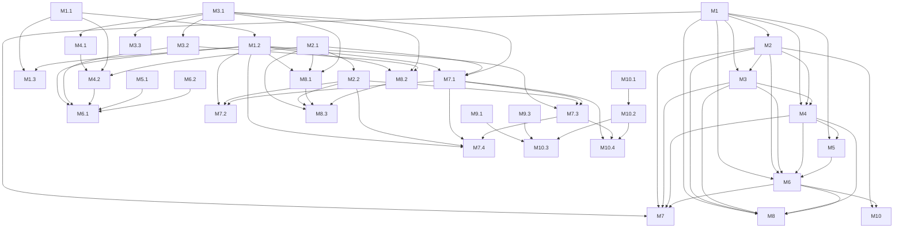

# 短视频下载器 规约 (v0.9.0)

> 业务层 → [prd.md](./prd.md)（本文件 Mx 模块与 prd 一一对应）

## 0. 元信息
- 状态：已确认（2026-10-29 架构讨论收敛，用户拍板重构）
- 日期：2026-10-29
- 决策人：bsawang
- 档位：完整档（模块边界变化）

## 1. 项目定位

页面附着的视频下载底座。通用能力（采集、交互、下载）与平台差异（规则、字段、锚点）分离；新增平台 = 新增一份适配 + 跑自检。

非目标见 §5。

## 2. 核心口径

### 2.1 中性数据契约

```ts
VideoItem = {
  videoId: string,            // 平台无关的唯一 id（抖音为 aweme_id，B站为当前分P的 cid）
  title: string,
  author: string,
  streams: Stream[],          // 按清晰度降序，至少 1 条
  pageKind?: 'card' | 'detail',
  fallback?: boolean,         // perf 兜底构造的条目（不进 store，仅本次渲染）
  [extra: string]: unknown    // 平台附加字段（如 B站 bvid/cid/page/pageCount/part），kernel 不读
}
Stream = { label: string, url?: string, qn?: number, itag?: number,
           kind?: 'video' | 'audio' | 'mux', audioItag?: number }
// label 如 "1080p" / "1080P"；url 为带签名的直链，能预取到时才填；
// 直链会过期的平台只记平台档位码（B站 qn / YouTube itag），点下载时由 adapter.resolveDownload 现取；
// kind 标记分离流（画面/音频各一条）；'mux' 表示该档由画面+音轨合并输出，缺省为可直接播放的单文件流
DownloadPlan = { url: string, credentials: 'omit' | 'include', headers?: Record<string,string>, filename?: string }
MuxPlan = { parts: [DownloadPlan, DownloadPlan], merge: 'fmp4', filename?: string } // parts[0] 画面，parts[1] 音轨
```

### 2.2 平台适配契约

```ts
PlatformAdapter = {
  id: string,
  matches: string[],                       // content-script 匹配模式
  sources: Source[],                       // 采集源，见 M1.2
  domSources?: DomSource[],                // DOM 采集源（接口数据被归一到组件树后的兜底），见 M1.2
  ssrSelector: string | null,              // 无 SSR 采集源时为 null
  perfPattern: RegExp | null,              // 无性能兜底源时为 null
  refresh?: (store: Store) => Promise<void>, // 平台数据需现取时由 adapter 自己拉，见 M1.2
  parse(raw: object): VideoItem | null,    // 平台原始条目 → 中性条目
  normalizeStreams(raw: object): Stream[], // 平台清晰度 → 中性流
  resolveDownload(item: VideoItem, stream: Stream): DownloadPlan | MuxPlan | Promise<DownloadPlan | MuxPlan>, // 允许异步现取直链、合并档返回两路
  filename?(item: VideoItem, stream: Stream): string, // 平台自定义文件名（B站含分P），缺省用 kernel 规则
  streamToDisk?: boolean,                  // 长视频落盘：true 时走 File System Access，见 M2.2
  stub?(videoId: string, el: Element, rule: AnchorRule): VideoItem | null, // 只知 id 时先挂占位条目，见 M7.4
  loadItem?(videoId: string, store: Store): Promise<VideoItem>,            // 点击时补齐占位条目（可能发请求）
  prefetch?(videoId: string, store: Store): void,                          // hover 预热，失败静默
  anchors: AnchorRule[]                    // 见 M3.1
}
Source = { id: string, priority: number, reachableInPage: boolean,
           match(url: string): boolean, extract(text: string): object[] }
DomSource = { id: string, scan(root: Document): VideoItem[] }
AnchorRule = { selector: string, kind: 'card' | 'detail', mount: string[],   // 'self' | CSS 选择器，按序回退
               idFrom: { type: 'attr' | 'idPrefix' | 'className' | 'mediaSrc' | 'innerHref', ... }
                       | ((el: Element) => string | null),                  // 函数形式：DOM 无 id 信号时由平台自行取
               pageScope?: RegExp, resolve?(el: Element): Element,
               iconRight?: number,                                        // 列表按钮右偏移 px（让开站内控件）
               alwaysShow?: boolean,                                      // 卡片按钮常显，不等 hover（点击后站点插入覆盖层、hover 失效时用）
               overlay?: boolean,                                         // 按钮挂页面级浮层并按挂载元素定位（卡片的层叠上下文压不过站点覆盖层时用）
               pos?: { top?: number, right?: number, bottom?: number, left?: number } } // 详情按钮四边偏移 px，缺省 right/bottom 16
```

### 2.3 硬边界

1. `src/kernel/**` 内不得出现平台字符串（域名、字段名、selector、清晰度命名）。
2. `src/platforms/**` 不得调用宿主 API（`chrome.*`、`GM_*`、`unsafeWindow`）。
3. 只有 `src/entry/**` 可以接触宿主环境。
4. 阶段 0 行为与 v0.5.3 等价：同一页面按钮数、清晰度档位、下载文件名规则不变。

## 3. 架构概览

### 3.1 技术底座
- 运行时：浏览器页面上下文（Tampermonkey 5.3+，`@grant none`；Chrome/Edge 138+ 需开启“允许用户脚本”）。
- 源码：ESM JavaScript（无 TypeScript），**零第三方运行时依赖**。
- 构建/测试：Node.js 24.15.0，`node --test`，自研 30 行拼接构建器。
- 目标浏览器：Chrome/Edge 111+（页面 API 实际要求），TM 侧按 5.3+。

### 3.2 目录与模块边界

```
src/kernel/extract.js      纯函数：deepFind / parseLooseJSON / normalizeQuality / sortStreams / sanitizeName
src/kernel/store.js        候选仓库：upsert / merge / get
src/kernel/hook.js         多源采集调度（fetch/XHR/SSR/DOM/perf）
src/kernel/mount.js        规则驱动扫描 + 挂载
src/kernel/ui.js           hover / popover / toast
src/kernel/download.js     DownloadPlan → blob transport / File System Access 落盘 / 合并下载编排
src/kernel/merge.js        零依赖 fMP4 box 解析与音视频分片合并
src/kernel/core.js         组装 kernel，暴露 start(adapter)
src/platforms/douyin/rules.js    抖音全部常量与规则
src/platforms/douyin/adapter.js  parse / normalizeStreams / resolveDownload
src/platforms/bilibili/rules.js     B站全部常量、页面状态读取、锚点规则
src/platforms/bilibili/adapter.js   清晰度现取 / 直链解析 / 文件名 / refresh
src/platforms/xiaohongshu/rules.js    小红书全部常量、页面状态读取、锚点规则
src/platforms/xiaohongshu/adapter.js  笔记页现取 / 令牌缓存 / 直链解析 / 文件名 / refresh
src/entry/tm.js            按 URL 选 adapter 并调 start(adapter)
tools/build.mjs            ESM 拼接为单文件 user.js（合并各 adapter 的 @match）
tools/probe.mjs            CDP 四指标（阶段 0 仅骨架）
tests/*.test.mjs           node --test
tests/fixtures/*           样本与 legacy oracle
dist/douyin.user.js        构建产物
extension/                 冻结，仅回归沙箱
```

### 3.3 存储与通信
- 无持久化存储；候选仅内存 `Map<videoId, VideoItem>`。
- 单一页面上下文，kernel 内部为直接函数调用（不再需要跨世界 `postMessage`）。
- 采集中间态通过 `store.upsert` 汇合，UI 通过订阅回调刷新。

### 3.4 部署与运行
- `node tools/build.mjs` → `dist/douyin.user.js`（单文件，含 TM 元数据头）。
- 分发：TM 安装该文件；`@updateURL`/`@downloadURL` 指向 Releases 固定别名 `https://github.com/bsawang/video-downloader/releases/latest/download/douyin.user.js`，发版只需在新 release 挂同名资产。
- 回归沙箱：`extension/` 保留，用 `spikes/run.py --mode plugin` 对照旧行为。

### 3.5 约定
- ESM：每个模块只做命名导出，构建器剥离 `import`/`export` 后按固定拓扑序拼接。
- 命名：kernel 内函数不与平台词汇混用；平台词汇只允许出现在 `src/platforms/**`。因构建产物是单一作用域，各平台模块的顶层函数名必须全局唯一（B站侧统一 `bili` 前缀，小红书侧统一 `xhs` 前缀）。
- 日志：kernel 用 `log(level, ...)` 包装 `console`，默认 `warn` 以上输出；调试开关 `globalThis.__DL_DEBUG`。
- 测试组织：`tests/<module>.test.mjs`，fixture 放 `tests/fixtures/`。

### 3.6 选型记录
| 选什么 | 理由 | 被否决的替代方案 |
|---|---|---|
| 单一实施形态：TM 脚本 | 加平台只改 `@match`；`@updateURL` 自动更新；无需签名打包 | MV3 扩展（更新需重装）；TM + 扩展双产物（并行维护，已由用户否决） |
| ESM + 自研拼接构建 | 规模 <1500 行，零依赖，输出可读 | esbuild / rollup（引入构建依赖，收益低） |
| `@grant none` 单世界 | 页面上下文可直接 hook fetch/XHR，与现有能力等价 | `@grant GM_download` 沙箱世界（hook 需 unsafeWindow/注入，未验证）；双脚本 postMessage（分发变复杂） |
| 阶段 0 保留 blob 下载 | 行为等价，零风险 | 立即切 `GM_download`（阶段 0 无 GM API，且属功能变更） |
| 声明式锚点规则 | 规则是平台数据，扫描器可复用 | 通用 DOM 匹配器（平台差异无法稳定覆盖） |
| 验证通道：CDP（Node 内置 WebSocket，`tools/probe.mjs`） | 与用户实际调试方式一致，可复用已登录的本机 Chrome；注入 + 读 `__dlStats` 同一通道完成 | Playwright（另起 profile → 登录态失效、与用户 9222 端口冲突、匿名 headless 被判验证码；`spikes/verify_tm.py`、`spikes/verify_dom.py` 为历史脚本，默认不再使用） |
| 更新源：Releases 固定别名 `releases/latest/download/douyin.user.js` | 换版本只重发同名资产，脚本头的 URL 恒定；`dist/` 继续忽略，产物不进 git 历史 | `raw.githubusercontent.com` 直链（须把构建产物提交入库，与 `dist/` 忽略规则冲突，且每次发版产生二进制 diff）；`gh-pages` 分支（多一条发布链路，收益低） |
| B站清晰度用旧版 `playurl`（`fnval=1` → 单文件 `durl`），单文件拿不到的高档位另取 DASH 拆成「画面/音频」两条 | 低档直接得到可播放单文件；`accept_quality/accept_description` 只列当前账号在该视频上真实可取的档位；高档位先以分流提供，避免引入合流依赖 | 只用 DASH 一步到位（音视频分离，必须合流；合流见待定项 #3）；`__playinfo__` 首屏 SSR：切 P 后不更新，且档位受登录态限制不如接口真实 |
| B站长视频落盘走 File System Access（`showSaveFilePicker` + `createWritable`） | 3GB+ 单文件流式写盘，不整份驻留内存；picker 在点击的同步激活里弹出 | `GM_download`（需改 `@grant`/双世界，与 `@grant none` 单世界选型冲突，且 TM 下载器另起请求拿不到登录态）；继续用 blob（4 小时视频实测 3,482,563,020 B，内存扛不住） |

## 4. 功能需求

**子需求状态索引（progress 独占更新，spec 只填初始全 ⬜）：**
| 编号 | 模块 | 子需求 | 状态 |
|---|---|---|---|
| M1.1 | M1 | 通用递归提取与宽松解析 | 🟢 |
| M1.2 | M1 | 多源采集调度 | 🟢 |
| M1.3 | M1 | 候选去重与合并 | 🟢 |
| M2.1 | M2 | 清晰度标准化 | 🟢 |
| M2.2 | M2 | 下载计划与执行 | 🟢 |
| M3.1 | M3 | 规则驱动锚点扫描与挂载 | 🟢 |
| M3.2 | M3 | 按钮/菜单/toast 交互 | 🟢 |
| M3.3 | M3 | 详情弹层「作者作品」列表锚点与 fiber 数据源 | 🟢 |
| M4.1 | M4 | 抖音规则表 | 🟢 |
| M4.2 | M4 | 抖音适配钩子 | 🟢 |
| M5.1 | M5 | probe 四指标 | 🟢 |
| M6.1 | M6 | 构建与组装 | 🟢 |
| M6.2 | M6 | 行为基准 | 🟢 |
| M7.1 | M7 | B站详情页识别与清晰度 | 🟢 |
| M7.2 | M7 | 多分P切换与长视频落盘 | 🟢 |
| M7.3 | M7 | DASH 高档位分离流下载 | 🟢 |
| M7.4 | M7 | 卡片页按钮注入（占位挂载 + 现取档位） | 🟢 |
| M8.1 | M8 | 笔记详情页识别与清晰度 | 🟢 |
| M8.2 | M8 | 卡片页占位挂载与令牌现取 | 🟢 |
| M8.3 | M8 | 签名直链现取与 http→https 升级 | 🟢 |
| M9.1 | M9 | 播放页识别与清晰度 | 🟢 |
| M9.2 | M9 | 列表卡片占位挂载与现取 | 🟢 |
| M9.3 | M9 | 直链现取与分离流命名 | 🟢 |
| M9.4 | M9 | Shorts 播放页与 Shorts 卡片 | 🟢 |
| M10.1 | M10 | fMP4 分片合并 | ✅ |
| M10.2 | M10 | 合并下载执行 | ✅ |
| M10.3 | M10 | YouTube 合并档位 | ✅ |
| M10.4 | M10 | B站合并档位 | ✅ |

### 需求树（依赖图）



### M1 视频识别与数据采集 🟢
模块概要：
- 职责：把页面自身数据流中的视频条目转成中性 `VideoItem` 并汇总
- 输入：页面网络响应体 / SSR 脚本 / performance 资源
- 输出：`store` 中的 `Map<videoId, VideoItem>`
- 依赖：无
- 被谁依赖：M2、M3、M4、M5、M6

#### M1.1 通用递归提取与宽松解析 🟢
- **验收**：`node --test tests/extract.test.mjs` 全绿；对含嵌套 `aweme_detail`、JSONL 流式帧、整体 JSON 三类 fixture，`parseLooseJSON` + `deepFind` 均产出预期条目
- **依赖**：无

详细设计：
- 数据流：`text → parseLooseJSON(text) → 依次 deepFind(obj, predicate) → rawItems[]`
- 接口：`parseLooseJSON(text): object[]`（逐行 `JSON.parse`，保留可解析对象；整体 JSON 额外尝试一次）；`deepFind(root, predicate, maxDepth=40): object[]`（深度优先，命中即收集且不再下钻命中节点）；`collect(text, source, adapter): VideoItem[]`（源提取 → 谓词命中 → `adapter.parse` → 按 `videoId` 去重）
- 数据结构：输出平台原始对象，不做字段映射
- 算法与规则：先逐行解析（流式帧/JSONL），再对全文整体解析；`seen` 以对象引用去重；深度上限 40 防环
- 错误与边界：解析异常静默跳过；`text` 非字符串返回 `[]`；空对象返回 `[]`
- 测试要点：M6.2 基准 1

#### M1.2 多源采集调度 🟢
- **验收**：详情页 fixture 下，hook 捕获的条目进入 store；`performance` 兜底源在无元数据时产出 `fallback` 标记；`__DL_DEBUG` 打开时日志含源 id
- **依赖**：M1.1

详细设计：
- 数据流：`start()` 安装 fetch/XHR hook → 响应 `text()` → 对每个 `adapter.sources` 中 `match(url)` 为真的源调用 `extract(text)` → `adapter.parse` → `store.upsert`；每 2000ms 另跑 `adapter.domSources` 扫 DOM，并调用一次 `adapter.refresh(store)`（若平台提供）
- 接口：`installNetworkHooks(adapter, store): typeof fetch`（返回原生 fetch 供下载复用）；`scanSSR(adapter, store)`；`scanDomSources(adapter, store)`；`scanPerformance(adapter): string|null`；`refreshSources()`（内部，启动后 500ms 与每 2000ms 各触发一次）；`debug(...args)`（受 `globalThis.__DL_DEBUG` 控制）；定时器 2000ms
- 数据结构：`Source` / `DomSource` 见 §2.2
- 算法与规则：fetch 用 `resp.clone().text()`，不阻塞原请求；XHR 用 `load` 事件读 `responseText`；SSR 解析失败时尝试 `decodeURIComponent`；DOM 源只在 `streams` 与仓库内已有条目不一致时写入，避免空转触发重渲染；perf 只取最后一个匹配 URL；`refresh` 的节流/去重责任在 adapter（kernel 只负责定时触发并吞掉异常）
- 错误与边界：任何解析异常吞掉并 `log('warn')`；跨域响应读取失败跳过；`resp.body` 为空跳过；单个 DOM 源抛错不影响后续源
- 测试要点：M6.2 基准 1 + 浏览器冒烟

#### M1.3 候选去重与合并 🟢
- **验收**：同一 `videoId` 多次 `upsert`，`store.size` 不变，最终条目为最后一次写入（与 v0.5.3 的 `Map.set` 行为等价）
- **依赖**：M1.1、M1.2

详细设计：
- 数据流：`upsert(item)` → 已存在则整体覆盖 → 通知订阅者
- 接口：`upsert(item): VideoItem|null`；`get(videoId): VideoItem|undefined`；`entries(): VideoItem[]`；`onChange(cb)`
- 数据结构：内部 `Map<string, VideoItem>`
- 算法与规则：后到覆盖（阶段 0 为行为等价，不做多源并集）；`streams` 写入时按 label 数字降序稳定排序
- 错误与边界：`videoId` 空字符串拒绝写入；`streams` 为空仍写入（供 UI 判定不可下载）
- 测试要点：M6.2 基准 1

### M2 清晰度解析与下载 🟢
模块概要：
- 职责：把平台清晰度描述转成用户可选项，并执行下载
- 输入：平台 `video` 对象 / `DownloadPlan`
- 输出：`Stream[]` / 浏览器文件下载
- 依赖：M1
- 被谁依赖：M3、M4、M6

#### M2.1 清晰度标准化 🟢
- **验收**：`adapt_lowest_4_1`、`pay_bvc1_hdr_xxx`（无 3–4 位数字段）被过滤；`normal_1080_0` → `1080p`；无标准档时回退 `默认`（取自 `play_addr`）；与 v0.5.3 `normalizeStreams` 逐条一致
- **依赖**：无（契约上属于 M1 输出的一部分）

详细设计：
- 数据流：`raw.video.bit_rate[] → 逐档取 gear_name → 映射 label → 过滤特殊流 → 去重`
- 接口：`normalizeQuality(gearName, mapping): string|null`；平台侧 `normalizeStreams(raw): Stream[]`
- 数据结构：`Stream` 见 §2.1；映射表 `{"normal_1080_0":"1080p", ...}` 由平台提供
- 算法与规则：先查显式映射；否则提取 `/(\d{3,4})/` 数字 + `p`；`adapt|pay_|hdr` 关键字直接丢弃；同 label 只留第一档
- 错误与边界：无 `url_list` 跳过；全部过滤后为空则回退 `play_addr.url_list[0]` 标 `默认`
- 测试要点：M6.2 基准 1

#### M2.2 下载计划与执行 🟢
- **验收**：点“1080p”后产生 `作者_标题_1080p.mp4` 文件；progress 回调至少触发一次；失败时 toast 含 HTTP 状态码；`streamToDisk` 平台点选后先弹保存对话框，字节数落盘等于服务端 `content-length`，blob 不进内存
- **依赖**：M2.1

详细设计：
- 数据流（blob 路径）：UI 选档 → 把 `adapter.resolveDownload(item, stream)` 包成 Promise → `download(planPromise, opts)` → `fetch(credentials)` → 流式读 → `Blob` → `<a download>` → 撤销 blob URL
- 数据流（落盘路径，`opts.streamToDisk` 且 `showSaveFilePicker` 可用）：同一入口先同步调 `showSaveFilePicker({suggestedName})`（保住用户点击的激活态）→ `createWritable()` → 再 `await` 计划 Promise → `fetch` → 每块 `writable.write(value)` → `close()`
- 接口：`download(planOrPromise, { streamToDisk?, suggestedName? }): Promise<boolean>`；`createDownloader({nativeFetch, toast})`
- 数据结构：`DownloadPlan` 见 §2.1；`plan.filename` 可缺省（落盘路径用 `suggestedName`）
- 算法与规则：`credentials` 由平台给（抖音 `omit`，B站直链 `omit`）；文件名 `sanitize(author + '_' + title + '_' + label) + '.mp4'`，平台可提供 `adapter.filename` 覆盖（B站含分P）；每读一块上报 `received/total`；Picker 的 `AbortError` 视为用户取消，不发请求
- 错误与边界：非 2xx 回报 `HTTP <status>`（落盘路径先 `writable.abort()`）；`content-length` 缺失时进度显示 `…`；`content-length` 存在但实际收到字节更少（代理/边节点截断）→ `writable.abort()` 丢弃半成品并提示「数据不完整（收到/总字节）」，不得报「下载完成」；异常回报字符串错误并中止可写流；blob URL 10s 后释放；无 `showSaveFilePicker` 时静默回落 blob 路径
- 测试要点：`tests/download.test.mjs`（blob 路径、Promise 计划、落盘路径字节一致、字节不足判失败、取消不请求） + 浏览器冒烟（下载落盘）

### M3 页面附着交互 🟢
模块概要：
- 职责：在页面视频元素上叠加下载入口与清晰度菜单
- 输入：`AnchorRule[]` + `store`
- 输出：DOM 按钮 / popover / toast
- 依赖：M1、M2
- 被谁依赖：M4、M6

#### M3.1 规则驱动锚点扫描与挂载 🟢
- **验收**：给定 6 条抖音规则（第 6 条见 [M3.3](#m33)），首页/搜索/详情/单列流/个人主页分别扫出与 v0.5.3 相同的卡片集合；`mount` 回退顺序为 `.videoImage → 自身非 static → 内部视频链接`
- **依赖**：无

详细设计：
- 数据流：`renderAll()` → 对每条 `AnchorRule` 执行 `querySelectorAll` → 提取 id → `store.get(id)` → `mountButton`
- 接口：`scan(rules, root=document): {el, videoId, kind}[]`；`mountButton(el, item, rule)`
- 数据结构：`AnchorRule` 见 §2.2
- 算法与规则：`idFrom` 五种声明式提取（属性值 / id 前缀 / class 名正则 / 媒体 src 正则 / 内部链接正则）或函数形式；`pageScope` 不匹配时跳过该规则；已挂载元素记录 `videoId`，同一元素 id 变了先移除旧按钮再挂（列表虚拟滚动会复用节点）
- 错误与边界：无候选数据时详情页可用 perf 兜底（标 `当前清晰度`）；卡片为图文时无视频 id，跳过
- 测试要点：浏览器冒烟

#### M3.2 按钮/菜单/toast 交互 🟢
- **验收**：hover 前按钮 `display:none`、hover 后显示；popover 在视口内翻转不越界；点外部/滚动关闭；toast 2.5s 自动消失
- **依赖**：M3.1

详细设计：
- 数据流：按钮 click → `openPopover(btn, item)` → 列 `streams` → click → `resolveDownload` + `download`
- 接口：`createMountButton(item, {onPick})`；`openPopover(anchorEl, item, onPick)`；`toast(msg)`
- 数据结构：popover 为 `position:fixed`，`data-dl-pop` 标记
- 算法与规则：`rect.right - 165` 且不小于 8；下方空间不足则向上翻转；`document.documentElement` 挂载
- 错误与边界：`streams` 为空不弹菜单；重复打开先关闭旧 popover
- 测试要点：浏览器冒烟

#### M3.3 详情弹层「作者作品」列表锚点 🟢
- **验收**：打开视频播放页（`https://www.douyin.com/jingxuan?modal_id=<id>`）并点左下用户名 / 右上头像展开右侧「作者作品」列表，`[data-e2e="author-card-list"] li` 的每个可见条目都出现 ⬇ 按钮；点开弹出该条清晰度，下载文件名含该条 `作者_标题_清晰度`；React 属性缺失的条目跳过且无 pageerror
- **依赖**：M3.1

详细设计：
- 数据流：每 2000ms `scanDomSources` 走 `douyin-fiber` 源：`querySelectorAll('[data-e2e="author-card-list"] li')` → 读 fiber 的 `awemeInfo` → `fiberToRaw` 折回接口形状 → `adapter.parse` → `store.upsert`；`renderAll` 的第 6 条锚点规则用同一个 fiber 读 id → `store.get(videoId)` → `pickAnchor(['self'])` → 叠按钮
- 接口：`idFrom: (el) => string | null`（kernel `extractId` 支持函数形式）；平台侧 `readAwemeInfo(el): object|null` / `readFiberAwemeId(el)` / `fiberToRaw(ai)` / `domSources[].scan(root)`
- 数据结构：该列表的 `li` 没有 id 属性、内部 `<a>` 没有 `href`（SPA onClick 跳转）。fiber 的 `awemeInfo` 是页面归一化后的 camelCase 结构（`awemeId` / `itemTitle` / `authorInfo.nickname` / `video.bitRateList[].{gearName,height,playAddr[].src}`），与接口原始 snake_case JSON 不同构，所以网络源拿不到这批条目；`fiberToRaw` 映射回 `aweme_id` / `desc` / `author.nickname` / `video.bit_rate[].{gear_name,play_addr.url_list}` 后复用同一套 `parse` 与清晰度规则
- 算法与规则：fiber 挂在 `li` 内的 `a` 上（`__reactFiber$*`）；沿 `fiber.return` 最多 15 层找 `memoizedProps.awemeInfo.awemeId`；`li` 计算样式为 `position:relative`，可 `mount: ['self']`；DOM 源每轮比对已有 `streams`，相同则不写（避免 2s 一次的空转重渲染）
- 错误与边界：无 fiber / 无 `awemeInfo` / `awemeId` 为空 → 返回 null 跳过（不抛错）；面板收起时列表可能不在 DOM，展开后下一轮（≤2s）自动补齐；列表虚拟滚动复用 `li` 时按 videoId 变化重挂，避免按钮指向旧视频
- 测试要点：`tests/rules.test.mjs` 用伪造 fiber 链测 `readFiberAwemeId`；`tests/mount.test.mjs` 测函数式 `idFrom` 与同元素去重；`tests/fiber.test.mjs` 测 `fiberToRaw → parse`、`scanDomSources` 去重与单源异常隔离；真页 CDP 冒烟：45 个 `li` → 45 个按钮、弹层 `1080p/720p/540p`、CDN 带 `omit` 取 Range 返回 `206 video/mp4`

### M4 平台适配 🟢
模块概要：
- 职责：承载一个平台的全部差异，不碰 kernel
- 输入：抖音原始数据 / 页面 DOM
- 输出：`PlatformAdapter`
- 依赖：M1、M2、M3（契约）
- 被谁依赖：M5、M6

#### M4.1 抖音规则表 🟢
- **验收**：`grep -rniE "douyin|aweme|douyinvod|waterfall|scroll-list|__vid|抖音" src/kernel/` 返回 0；规则表可被 probe 与构建同时 import
- **依赖**：M3.1

详细设计：
- 数据流：无运行时逻辑，纯导出
- 接口：`rules = { id, matches, cdnPattern, perfPattern, ssrSelector, qualityMap, isVideo, anchors, fallback }` + `sources: Source[]` + `domSources: DomSource[]`（adapter 以 spread 合并）
- 数据结构：`AnchorRule[]`，6 条：`[data-aweme-id]`、`[id^="waterfall_item_"]`、`[class*="video_"]`、`video[src*="__vid="]`、`/user/` 下 `ul[data-e2e="scroll-list"] > li a[href*="/video/"]`、`[data-e2e="author-card-list"] li`（见 [M3.3](#m33)）；`DomSource[]` 1 条：`douyin-fiber`
- 算法与规则：id 提取方式逐一对应现有代码（[isolated.v055.js:46-70](file:///E:/work/ai/video-downloader/extension/content/isolated.v055.js#L46-L70)）
- 错误与边界：规则表结构非法（缺 selector）在启动时 `throw`
- 测试要点：边界 grep + 浏览器冒烟

#### M4.2 抖音适配钩子 🟢
- **验收**：三份 fixture（详情 JSON / 搜索流式帧 / 推荐流 JSON）经 `parse` 后产出 `VideoItem`，字段与 v0.5.3 的 `simplify` 输出一致
- **依赖**：M4.1、M1.1、M2.1

详细设计：
- 数据流：`rawItem → parse → {videoId, title, author, streams, pageKind}`
- 接口：`parse(raw): VideoItem|null`；`normalizeStreams(raw): Stream[]`；`resolveDownload(item, stream): DownloadPlan`
- 数据结构：`VideoItem` / `DownloadPlan` 见 §2.1
- 算法与规则：`videoId = String(raw.aweme_id)`；`title = raw.desc`；`author = raw.author.nickname`；`pageKind` 阶段 0 不设（卡片/详情由锚点规则判定）；`credentials: 'omit'`
- 错误与边界：缺 `aweme_id` 或 `video` 返回 `null`；无直链返回 `streams: []`
- 测试要点：M6.2 基准 1

### M5 调研自检 🟢
模块概要：
- 职责：对目标页面回答“采集/命中/挂载/可下载”四项指标
- 输入：CDP 常驻浏览器 + 目标 URL + adapter
- 输出：四指标报告 + 每条数据的源可见性
- 依赖：M1、M4
- 被谁依赖：M6

#### M5.1 probe 四指标 🟢
- **验收**：`node tools/probe.mjs --url <详情页>` 输出 `candidates / anchors / mounted / downloadable` 四个数字；每条采集数据带 `reachableInPage`
- **依赖**：M1.2、M4.2

详细设计：
- 数据流：连接 CDP → 注入构建产物 → 等待 6s → 在页面内读取 `window.__dlStats` → 输出 JSON
- 接口：`probe(url, {cdpPort=9222}): Promise<Stats>`
- 数据结构：`Stats = {candidates, anchors, mounted, fallback, downloadable, sources:[{id, reachableInPage}]}`
- 算法与规则：`__dlStats` 由 kernel 在每次 `renderAll` 后更新；`reachableInPage` 由源声明（SSR/perf/network 为 true）；默认等待 6000ms（`--wait` 可调）
- 错误与边界：连不上 CDP → 退出码 2 并提示 `driver.py start`；页面无数据 → 输出全 0 而非报错
- 测试要点：浏览器冒烟

### M6 构建与分发 🟢
模块概要：
- 职责：源码 → 可安装单文件；锁住重构前后行为一致
- 输入：`src/**`
- 输出：`dist/douyin.user.js` + 测试报告
- 依赖：M1–M5
- 被谁依赖：无

#### M6.1 构建与组装 🟢
- **验收**：`node tools/build.mjs` 产出 `dist/douyin.user.js`（资产名保持不变，已安装用户的更新别名不断）；`node --check` 通过；文件头含 `@name/@version/@match/@run-at/@grant none` 与 `@updateURL/@downloadURL`（同指 Releases 固定别名），`@match` 覆盖全部已接入平台；版本号只来自 `package.json`
- **依赖**：M1.2、M3.2、M4.2、M5.1、M7.1

详细设计：
- 数据流：按拓扑序读文件 → 剥离 `import`/`export` 行 → 包进 IIFE → 拼接 TM 头 → 写 `dist/`
- 接口：`build(): Promise<string>`；`src/entry/tm.js` 按 `adapter.matches` 逐条匹配 `location.href`，命中则 `start(adapter)`
- 数据结构：TM 头字段：`@name`、`@namespace`、`@version`、`@description`、`@updateURL`、`@downloadURL`（后两者同指 `build.mjs` 的 `UPDATE_URL` 常量）、`@match`（各 adapter `matches` 并集去重）、`@run-at document-start`、`@grant none`
- 算法与规则：文件顺序固定为 `extract, store, hook, mount, ui, download, core, douyin/rules, douyin/adapter, bilibili/rules, bilibili/adapter, entry`；重复的顶层声明视为构建失败（单作用域拼接）；`*` 通配按正则转义匹配
- 错误与边界：缺文件 / 顺序错 → 构建失败并打印缺失项；`export` 残留 → 失败；新平台顶层名与现有冲突 → 构建报重复声明
- 测试要点：构建命令 + `node --check` + 真页注入产物

#### M6.2 行为基准 🟢
- **验收**：`node --test tests/*.test.mjs` 全绿；基准 1（legacy oracle 对比）覆盖 3 份 fixture；基准 2（UI 快照）对照 `spikes/out/run_20260801_163730_plugin/result.json` 的标题/作者/清晰度集合
- **依赖**：无（先于重构建立）

详细设计：
- 数据流：fixture → 旧实现（oracle，逐字复制 v0.5.3 的 `extractFromText`/`simplify`/`normalizeStreams`）→ 新实现 → 深比较
- 接口：`tests/fixtures/legacy.mjs` 导出 `legacyExtract(text)`、`legacySimplify(items)`、`legacyNormalizeStreams(video)`
- 数据结构：fixture 为 `.json` / `.txt`（流式帧）
- 算法与规则：比较 `videoId/title/author/streams[].label/streams[].url`，忽略顺序以外的差异；UI 快照比较集合
- 错误与边界：旧实现只能作为 oracle，不许在新代码中 import；快照页面若已失效，记录为 skip 并在报告中注明
- 测试要点：自身即测试

### M7 平台接入（B站）🟢
模块概要：
- 职责：B站详情页与卡片页的视频识别、清晰度获取、直链解析、下载命名，全部差异留在本模块
- 输入：详情页 `__INITIAL_STATE__` / 卡片 DOM / `view` 与 `playurl` 接口 / `#bilibili-player`
- 输出：`bilibiliAdapter`（`PlatformAdapter`）
- 依赖：M1、M2、M3（契约）
- 被谁依赖：M6

#### M7.1 B站详情页识别与清晰度 🟢
- **验收**：打开 `https://www.bilibili.com/video/BV...` 后播放器右上、站内「反馈」按钮左侧出现 **⬇ 下载**（不压底部控制条）；点开列出的档位与 `accept_description` 一致且按清晰度降序；档位上限随当前账号/视频真实能力变化（未登录可能只有 720P，登录/VIP 提高），不做写死；接口失败时无按钮且无 pageerror
- **依赖**：M1.2、M2.1、M3.1

详细设计：
- 数据流：entry 按 `matches` 选中 `bilibiliAdapter` → `start()` → 500ms / 每 2000ms `refresh` → `readBiliPage()` 读 `__INITIAL_STATE__` 的 `bvid/cid/p` → `GET api.bilibili.com/x/player/playurl?bvid&cid&fnver=0&fourk=1&fnval=1&qn=127`（`credentials: include`）→ `buildBiliStreams(accept_quality, accept_description)` → `store.upsert` → `renderAll` 用 `#bilibili-player` 规则（`idFrom = readBiliPage().cid`）→ 按 `mount` 回退挂按钮
- 接口：`readBiliPage(loc?): {bvid,cid,page,title,author,part,pageCount}|null`；`biliPlayurlUrl(meta, qn): string`；`buildBiliStreams(data): Stream[]`；`biliParse(raw)`；`biliNormalizeStreams(raw)`；`biliResolveDownload(item, stream): Promise<DownloadPlan>`；`biliRefresh(store): Promise<void>`
- 数据结构：`Stream { label, qn }` 不预存 url；`VideoItem` 附加 `bvid/cid/page/pageCount/part`（kernel 不读）
- 算法与规则：当前分P取顶层 `__INITIAL_STATE__.p`/`.cid`（`videoData.cid` 恒为第 1P，不用）；缺 `p` 时回退 URL `?p=`，再回退第 1P；label 取 `accept_description[i]`，缺省 `${qn}P`，排序复用 `sortStreams` 的数字降序；`qn=127` 只为拿全量档位表，不代表实际可下载档；点选后按 `stream.qn` 重新请求同一接口取 `durl[0].url`；详情按钮用 `AnchorRule.pos = { top: 12, right: 56 }` 定位到 `.bpx-player-video-area` 右上，让开站内反馈按钮 `.bpx-player-top-issue`（36×24、右缩进 12）并垂直居中，底部控制条不再被遮挡
- 错误与边界：非 `/video/` 页无播放器 → 不挂；`__INITIAL_STATE__` 缺失或无 `videoData` → `readBiliPage` 返回 null（不发请求）；接口 `code !== 0` 或 `accept_quality` 为空 → 不写 store；`durl.length > 1` → toast「分段视频暂不支持（共 N 段）」；直链约 2 小时过期 → 点下载时现取
- 测试要点：`tests/bilibili.test.mjs`（页面状态读取、URL、档位排序、playurl 解析、直链解析、refresh 每 cid 一次、契约）；真页 CDP：短链视频弹层 `[1080P, 720P, 360P]`，选取后 CDN Range 请求 `206 video/mp4`

#### M7.2 多分P切换与长视频落盘 🟢
- **验收**：多分P视频切 P 后 2s 内按钮菜单跟随当前 P（标题/分P名/档位按新 cid 刷新）；下载文件名含 `P<n> <分P名>`；长视频点选后弹出保存对话框，落盘字节数等于服务端 `content-length`，且不构造整份 Blob
- **依赖**：M1.2、M2.2、M7.1

详细设计：
- 数据流：SPA 切 P → `__INITIAL_STATE__.cid/p` 变化 → 下一轮 `refresh`（≤2s）发现新 cid 不在 store → 请求 playurl → upsert → `renderAll` 以新 cid 命中锚点 → 按钮随播放器挂载；点选 → `biliFilename` 生成含分P名 → `download(planPromise, { streamToDisk: true, suggestedName })` → 保存对话框 → 逐块写盘
- 接口：`biliFilename(item, stream): string`；`download(planOrPromise, { streamToDisk?, suggestedName? }): Promise<boolean>`
- 数据结构：store 按 cid 存条目；切回已访问过的 P 时 `store.get(cid)` 命中，跳过请求
- 算法与规则：锚点 `idFrom` 用函数形式（DOM 无 id 信号）；`renderedIds` 记录 `{videoId, btn}` 并以 `btn.isConnected` 判断是否需补挂（SPA 重渲染会清掉外来节点）；`refresh` 每个 cid 成功一次，`biliFetching` 互斥，同 cid 失败后 5s 内不重试（避免 2s 定时器打爆接口）；文件名 `author_title_P{n} {part}_{label}.mp4`，`sanitizeName` 后 120 字符截断；落盘路径先同步弹出 picker 保住点击激活态，再等待直链 Promise
- 错误与边界：切 P 瞬间状态短暂为空 → 下一轮重试；URL `p` 越界回退第 1P；重复 upsert 由 store 按 cid 去重；picker 取消（`AbortError`）→ toast「已取消下载」且不发请求；浏览器不支持 `showSaveFilePicker` → 静默回落 blob 路径（超长视频有内存风险，README 注明）
- 测试要点：`tests/bilibili.test.mjs`（当前 P 定位、多分P文件名、refresh 每 cid 一次）；`tests/download.test.mjs`（Promise 计划、落盘字节、取消不请求）；真页 CDP：P3 → P1 菜单/文件名跟随，落盘 2,350,008 B 与服务端一致

#### M7.3 DASH 高档位分离流下载与合并 🟢
- **验收**：登录态下打开单文件仅 720P 的现代视频，菜单在 720P 之上出现「高清 1080P」（合并档，一条，不再另列「音频」）；点「高清 1080P」只弹一次保存对话框，两路 CDN 请求（画面 + 音轨）均返回 `206`，最终落成**一个可直接播放的 MP4**（单视频轨 + 单音轨）；单文件已含同档（旧视频 1080P）时不出现重复项；两路不是分片 MP4 或缺少 AAC 音轨时，回落为「画面（无音轨）」拆分档并在菜单明示
- **依赖**：M1.2、M2.2、M7.1、M10.2

详细设计：
- 数据流：`refresh` 并发请求 `fnval=1`（单文件低档）与 `fnval=4048`（DASH）→ `buildBiliDashStreams` 取 `dash.video` 中 `qn > 单文件最高档` 的档位，每档只给一条 `kind: "mux"`（合并）；store → 菜单；点合并档 → `biliResolveDownload` 按 `qn` 再请求 `fnval=4048`，同时取所选画面与标准 AAC → 返回 `MuxPlan` → kernel 合并下载（M10.2）
- 接口：`biliPlayurlUrl(meta, qn, fnval=1)`；`buildBiliDashStreams(durlData, dashData): Stream[]`；`biliParsePlayurl(data, meta, dashData?)`；`biliResolveDownload(item, stream)` 支持 `stream.kind` 的 `'mux' | 'video'`
- 数据结构：分离流无预置 `url`，合并档为 `{ label, qn, kind: "mux" }`；DASH 条目含 `id/codecid/bandwidth/baseUrl/backupUrl`；`MuxPlan.parts = [画面, 音频]`
- 算法与规则：`durlMax = max(单文件档 qn)`，只补严格大于它的档；同 qn 多编码取 `codecid=7`（AVC），否则取最高带宽（AV1/HEVC 仍是 m4s 分片，容器层可合并）；音频优先标准 AAC（`30216/30232/30280`）并取最高带宽；URL 依次取 `baseUrl → base_url → backupUrl[0]`；合并档标签为 `accept_description`，不再单独列音频档；合并档文件名扩展名 `.mp4`；`dash.audio` 为空时只给「画面（无音轨）」拆分档
- 错误与边界：DASH 请求失败不影响单文件档（`Promise.all` 各自 catch）；所选 qn 在 DASH 中不存在 → 「该清晰度不可用」；直链约 2 小时过期，点选时现取；合并失败（非分片 MP4 / 容器异常）→ `writable.abort()` 并提示，不产出半成品。**档位可得性随登录态**：未登录时 `dash.video` 不含 1080（接口 `accept_quality` 仍列 80 但不发流），菜单按实际 `dash.video` 档位补，故不出现死链行；登录非会员可得 1080P，1080P+（qn 112）需大会员。直链为 CDN 签名 URL（含 `deadline`），下载带 `credentials: "omit"` 可行，CDN 校验 `Referer`（浏览器同源策略下自动带上 `https://www.bilibili.com/`）
- 测试要点：`tests/bilibili.test.mjs`（只补高于单文件档、已含同档不重复、AVC 优先、AAC 最高码率、缺档报错、refresh 两路并发、合并档 `MuxPlan` 两路 URL）；`tests/merge.test.mjs`（合成 m4s 合并）；真页 CDP：菜单出现「高清 1080P」一条，点选后两条 CDN `206`，落盘单文件可播放

#### M7.4 卡片页按钮注入（占位挂载 + 现取档位）🟢
- **验收**：`www.bilibili.com` 首页、热门（推荐列表与排行）、`search.bilibili.com`、详情页右侧推荐位，每张带 `/video/BV` 链接的视频卡片 hover 出 ⬇（不与右上角「稍后再看」重叠）；点开菜单列出该视频真实档位（登录态含 1080P 合并档单条）；冷启动点击 ≤2s 出菜单；广告卡（只有 `cm.bilibili.com` 跳转、无 BV）不注入；多分P视频默认只下 P1
- **依赖**：M1.2、M2.2、M7.1、M7.3

详细设计：
- 数据流：`scan` 命中卡片规则得到 bvid → `adapter.stub(bvid, el)` 生成空 streams 占位条目并立即挂按钮 → 锚点 `mouseenter` 调 `prefetch(bvid)`：`GET x/web-interface/view?bvid` 取 `pages[0].cid`/标题/作者 → 并发 `playurl`（`fnval=1` 与 `fnval=4048`）→ `biliParsePlayurl` → `store.upsert` → 菜单就绪；点击时 `loadItem(bvid)` 命中 store 直接返回，未命中则现取（toast「正在获取清晰度…」）
- 接口：`PlatformAdapter.stub?(videoId, el, rule): VideoItem`；`loadItem?(videoId, store): Promise<VideoItem>`；`prefetch?(videoId, store): void`；`AnchorRule.iconRight?: number`（px，仅列表按钮）；kernel `createButton` 增加 `onOpen`（点击时异步取条目）
- 数据结构：占位条目 `{ videoId: bvid, bvid, title, author: "", streams: [] }`；卡片页 `videoId` 统一用 bvid（详情页仍用 cid）；`cardPending: Map<bvid, Promise>` 并发去重；`renderedIds: WeakMap<el, {videoId, btn}>` 维持复用节点的补挂
- 算法与规则：`biliCardBvid` 依次读卡片内 `a[href]` 与 `a[data-target-url]`，取首个 `/video/BV...` 的 `BV[0-9A-Za-z]{10}`（广告卡的 `href` 是 `cm.bilibili.com` 埋点，真实目标在 `data-target-url`）；`biliCardTitle` 依次尝试 `.bili-video-card__info--tit` / `.video-card__info-title` / `.title`；卡片规则四条——`.bili-video-card`（首页/搜索/推荐流，mount `self`）、`.video-card`（热门列表，mount `.video-card__content`）、`.rank-item`（排行，mount `.img`）、`.video-page-card-small`（详情页推荐位，mount `.pic`）；`iconRight: 44` 让开站内右上角控件；`biliRefresh` 在非 `/video/` 路径直接返回，避免把首页 `__INITIAL_STATE__` 误当播放页；hover 预取读 `renderedIds` 当前映射，节点复用后仍指向正确 bvid
- 错误与边界：广告卡无 BV → 自然跳过；`view` 或 `playurl` 失败 → 点击时 toast 错误、按钮保留可重试，`finally` 清 `cardPending`；同卡并发点击/hover 只发一轮请求；条目已有 streams 时 `prefetch`/`loadItem` 直接返回；多分P只取 `pages[0]`，不提供分P选择；搜索页 hover 预览播放器可能覆盖卡片，按钮 z-index 与偏移保证仍可点
- 测试要点：`tests/bilibili.test.mjs`（BV 提取、标题选择器链、四条规则与 iconRight、`biliLoadCard` 三请求+缓存+并发去重+失败可重试、`biliPrefetch` 跳过已有 cid 条目、adapter 暴露 stub/loadItem/prefetch）；真页 CDP：首页 8/8、热门 20/20、排行 100/100、搜索 39–40（广告跳过）、详情推荐位 20/20；hover 预取 3 请求；菜单 4 行；360P 落盘 10,178,574 B

### M8 平台接入（小红书）🟢
模块概要：
- 职责：小红书笔记详情页/弹层与发现页视频卡片的识别、清晰度获取、直链解析、下载命名，全部差异留在本模块
- 输入：页面内联 `__INITIAL_STATE__`（`note.noteDetailMap`）/ 卡片 DOM（`section.note-item[data-note-id]`、`a.cover` 上的 `xsec_token`）/ 同源笔记页 HTML
- 输出：`xiaohongshuAdapter`（`PlatformAdapter`）
- 依赖：M1、M2、M3（契约）
- 被谁依赖：M6

#### M8.1 笔记详情页识别与清晰度 🟢
- **验收**：打开 `https://www.xiaohongshu.com/explore/<24位id>?xsec_token=...`（或从发现页点开弹层）后，播放器右上 12px 处出现 **⬇ 下载**（不压 xgplayer 底部控制条）；点开菜单列出的档位与 `note.video.media.stream` 中真实条目一致、按清晰度降序、同分辨率优先 EF4；图文笔记的 `#noteContainer` 不挂按钮；页面无 pageerror
- **依赖**：M1.2、M2.1、M3.1

详细设计：
- 数据流：entry 按 `matches` 选中 `xiaohongshuAdapter` → `start()` → 500ms / 每 2000ms `refresh` → `xhsRefresh` 遍历 `__INITIAL_STATE__.note.noteDetailMap` → 视频笔记 `xhsNoteToItem` → `store.upsert` → `renderAll` 用 `#noteContainer` 规则（`idFrom` = 路径 id 且状态里是视频笔记）→ `mount` 依次取 `.player-container` / `.media-container` / `self` → `pos = { top: 12, right: 12 }`
- 接口：`xhsNoteIdFromPath(pathname): string|null`；`xhsTokenFromLocation(): string`；`xhsDetailMap()`；`xhsStateNote(id)`；`xhsIsVideoNote(note)`；`xhsBuildStreams(video): Stream[]`；`xhsNoteToItem(note, fallbackId?)`；`xhsRefresh(store): Promise<void>`
- 数据结构：`Stream { label, url }`（`url` 已归一为 https）；`VideoItem { videoId: noteId, title: note.title || note.desc(80), author: note.user.nickname, streams }`；`xhsTokens: Map<id, token>`（平台内部）
- 算法与规则：label 取 `min(width,height) + "p"`（竖屏 720×1280 记 720p）；同一 label 按 `CODEC_RANK`（EF4=0 H.264、EF5=1 HEVC、其余=2）优先、同编码取 `avgBitrate` 更高者；排序复用 `sortStreams`；详情按钮挂播放器容器（右侧面板展开时收窄的是播放器，按钮随之移动），右上 12px 避开底部控件条
- 错误与边界：直开详情页时 `noteDetailMap` 晚于首帧就绪 → `idFrom` 返回 null 不挂按钮，2s 内随 refresh 自愈；图文/无 `video` 的笔记不写 store；`#noteContainer` 在发现页也存在但路径不是笔记页 → `idFrom` 自然为 null；`note.noteId` 缺失时用路径 id 兜底
- 测试要点：`tests/xiaohongshu.test.mjs`（路径解析、竖屏短边命名、EF4 优先、跨编码补档、缺链/缺尺寸跳过、`xhsIsVideoNote`/`xhsNoteToItem`、规则与 `pos`）；真页 CDP（`6ac31b54…`）：`{candidates:1, anchors:12, mounted:12, downloadable:1}`；按钮 91×37 @ (936,44)，播放器 (441,32,599,799)，间距 12/12，点中心命中 `BUTTON`

#### M8.2 卡片页占位挂载与令牌现取 🟢
- **验收**：发现页（`/explore`）每张视频笔记卡（`.note-item` 内含 `.play-icon`）hover 出 ⬇（右上 8px，不遮站内控件），图文卡不注入；hover 后 ≤2s 菜单列出该笔记真实档位；冷启动直接点按钮时先 toast「正在获取清晰度…」再出菜单；卡片无 `xsec_token` 且页面状态里没有该笔记时不挂按钮
- **依赖**：M1.2、M3.1、M3.2

详细设计：
- 数据流：`scan` 命中 `.note-item` 且卡片有 `.play-icon` → `xhsStub` 取 DOM 标题/作者与 `a[href*=xsec_token]` 令牌（记住）→ 立即挂按钮 → 锚点 `mouseenter` 调 `xhsPrefetch` → `xhsLoadNote`：页面状态命中直接转条目；否则 `GET /explore/<id>?xsec_token=<token>`（同源，`credentials: include`）→ `xhsStateFromHtml` 取内联状态 → 校验视频类型 → `xhsNoteToItem` → `store.upsert`
- 接口：`xhsStub(videoId, el, rule)`；`xhsLoadNote(id, store): Promise<VideoItem>`；`xhsPrefetch(videoId, store): void`；`xhsFetchNote(id, token): Promise<note>`；`xhsCardToken/Title/Author(el)`；`xhsNoteUrl(id, token)`；`xhsStateFromHtml(html)`
- 数据结构：占位条目 `{ videoId: noteId, title, author, streams: [] }`；`xhsTokens: Map<noteId, token>`；`xhsPending: Map<noteId, Promise>` 并发去重
- 算法与规则：令牌从卡片链接 `xsec_token` 解码后只存不拼 DOM；笔记页 HTML 中的 `window.__INITIAL_STATE__` 是 JS 字面量（含裸 `undefined/NaN/Infinity`），先严格 `JSON.parse`，失败再把“值位置”上的裸字面量替换为 `null` 重试；卡片 `videoId` 统一用 `data-note-id`；同一 id 并发只发一轮请求，成功后写 store，失败清 pending 允许重试；`prefetch` 遇已有 streams 直接返回
- 错误与边界：无令牌且状态无该笔记 → `stub` 返回 null（不挂按钮，避免点了才知道失败）；令牌缺失/失效时服务端返回「页面不见了」→ `xhsFetchNote` 抛「获取视频信息失败」；图文笔记 → 「该笔记不是视频」；`fetch` 非 2xx → `HTTP <status>`；hover 预取失败静默（不打扰浏览），点击时再报错
- 测试要点：`tests/xiaohongshu.test.mjs`（令牌解码、标题/作者选择器、裸字面量状态解析、`xhsLoadNote` 请求 URL/缓存/并发合并/失败可重试/状态就绪不发请求、`xhsPrefetch` 跳过已有档位、`xhsStub` 卡片-详情-null 三态）；真页 CDP（`/explore`）：30 张卡中 12 张视频卡全部挂按钮、图文卡 0；hover 后 `candidates 0→1`、`downloadable 0→1`，按钮 38×25 @ (898,237) 对应卡片右上 8px；菜单 2 档（1080p/720p）

#### M8.3 签名直链现取与 http→https 升级 🟢
- **验收**：点选任一档后发出的请求是该笔记的 CDN 直链（带 `sign` 等签名参数、不带 Cookie），`Range: bytes=0-1023` 返回 `206` 与 `video/mp4`；服务端给 `http://` 直链时实际请求为 `https://` 且成功；重新解析失败时退回菜单里的旧链，仍无可用直链则 toast「该清晰度不可用」；文件名形如 `作者_标题_1080p.mp4`
- **依赖**：M2.1、M2.2、M8.1

详细设计：
- 数据流：`onPick` → `xhsResolveDownload(item, stream)`：页面状态命中 → 直接 `xhsBuildStreams`；否则用记住的令牌重取笔记页 → 按 `label` 找新链 → 命中即用、未命中退回 `stream.url` → `download(planPromise)` → kernel `nativeFetch` 取流 → blob 落盘（`streamToDisk` 未开）
- 接口：`xhsResolveDownload(item, stream): Promise<DownloadPlan>`；`xhsFilename(item, stream): string`；`xhsBuildStreams(video)`
- 数据结构：`DownloadPlan { url, credentials: "omit", filename }`；不预存 `qn`（小红书按 `label` 匹配）
- 算法与规则：文件名 `[author, title, label].join("_")` → `sanitizeName` → 空白折叠 → 截 120 字符 + `.mp4`；`xhsBuildStreams` 把 `http://` 前缀统一换成 `https://`（https 页面上 fetch http 直链会被混合内容拦截，同主机同签名的 https 可用，实测 206）
- 错误与边界：签名直链有时效 → 点选时重取，取不到用菜单旧链；两路都没有 → 「该清晰度不可用」；CDN 非 2xx → kernel toast「下载失败：HTTP <status>」；大文件整份进内存（小红书短视频，不做落盘分块）
- 测试要点：`tests/xiaohongshu.test.mjs`（重取新链/退回旧链/两路皆无报错、http→https、文件名）；真页 CDP：卡片 `1080p` 点选后请求 `https://sns-video-v4.xhscdn.com/...sign=...` 传输 139,056,187 B；直链 Range 校验 `206 / video/mp4 / ftyp`

### M9 平台接入（YouTube）🟢
模块概要：
- 职责：YouTube 播放页与列表卡片的识别、档位获取、直链解析、下载命名，全部差异留在本模块
- 输入：页面地址 `watch?v=<11位id>` / `shorts/<11位id>` / 卡片 DOM（`yt-lockup-view-model`、`ytm-shorts-lockup-view-model`、`ytd-video-renderer`、`ytd-compact-video-renderer`、`ytd-reel-item-renderer` 内的 `/watch?v=` 或 `/shorts/` 链接）/ 同源 `youtubei/v1/player`（客户端 `VISIONOS` → `IOS` → `ANDROID_VR` 依次兜底）
- 输出：`youtubeAdapter`（`PlatformAdapter`）
- 依赖：M1、M2、M3（契约）
- 被谁依赖：M6

#### M9.1 播放页识别与清晰度 🟢
- **验收**：打开 `https://www.youtube.com/watch?v=<11位id>` 后，播放器右上 12px 处出现 **⬇ 下载**；菜单按清晰度降序列出 `Np`（单文件含音轨）、`Np`（自适应画面 + AAC 合并），与 `youtubei/v1/player` 返回的 `formats/adaptiveFormats` 一致；同分辨率按容器优先（MP4+avc1 → MP4+av01 → MP4 其它 → WebM）选流，1440p/2160p 由 AV1 MP4 与 AAC 合并成单条；单文件已覆盖的分辨率不再重复列画面；自适应画面为 WebM/VP9 或没有 AAC 音轨时，保留 `Np 画面（无音轨）` 拆分条目；只有存在拆分画面档时才额外列一条 `音频 <kbps>kbps`，全部能合并时不列音频；页面无 pageerror
- **依赖**：M1.2、M2.1、M3.1

详细设计：
- 数据流：entry 按 `matches` 选中 `youtubeAdapter` → `start()` → 500ms / 每 2000ms `refresh` → `ytRefresh` 从地址栏取 `v=` → 已有档位跳过，否则 `ytLoadVideo` 请求 InnerTube → `ytParsePlayer` 转条目 → `store.upsert` → `renderAll` 用 `#movie_player` 规则（`idFrom` 读地址栏 id）→ 挂 `self`，`pos = { top: 12, right: 12 }`
- 接口：`ytVideoIdFromUrl(href): string|null`；`ytCurrentVideoId(loc?): string|null`；`ytApiKey(): string`；`ytPlayerBody(videoId, client?)`；`ytFetchPlayer(videoId): Promise<object>`；`ytBuildStreams(data): Stream[]`；`ytParsePlayer(data, videoId?): VideoItem|null`；`ytLoadVideo(videoId, store): Promise<VideoItem>`；`ytRefresh(store): Promise<void>`；`ytStub(videoId, el, rule)`
- 数据结构：`Stream { label, url, itag, kind? }`（`kind` 缺省为单文件、`video`/`audio` 为分离流）；`VideoItem { videoId, title: videoDetails.title, author: videoDetails.author, streams }`；`ytPending: Map<id, Promise>` 并发去重；`YT_CLIENTS` 依次为 `{ clientName: "VISIONOS", clientVersion: "1.02", deviceMake: "Apple", deviceModel: "RealityDevice17,1", osName: "visionOS", osVersion: "26.5.23O471", hl: "en", gl: "US" }`、`{ clientName: "IOS", clientVersion: "20.10.4", deviceModel: "iPhone16,2", osName: "iPhone", osVersion: "18.3.2.22D82", hl: "en", gl: "US" }` 与 `{ clientName: "ANDROID_VR", clientVersion: "1.62.27", androidSdkVersion: 32, osName: "Android", osVersion: "12", deviceMake: "Oculus", deviceModel: "Quest 3", hl: "en", gl: "US" }`
- 算法与规则：API key 取 `ytcfg.get("INNERTUBE_API_KEY")`，取不到用固定 key 兜底；`formats` 中 `mimeType` 以 `video/` 开头且有 `url` 的按 `qualityLabel` 入列（单文件含音轨，label 即 `qualityLabel`）；`adaptiveFormats` 中视频按 `qualityLabel` 分组，组内按容器优先（`video/mp4` + avc1 → `video/mp4` + av01 → MP4 其它 → WebM + vp9 → WebM + av01，同档再比 `bitrate`）取最优；单文件已占用同 `qualityLabel` 时整档跳过；选中项是 `video/mp4` 且存在 AAC 音轨（`audio/mp4` 中码率最高）时，该档输出一条 `kind: "mux"`（label 即 `qualityLabel`，附 `audioItag`），否则输出 `qualityLabel + " 画面（无音轨）"` 的 `kind: "video"`；仅当菜单里存在 `kind: "video"` 拆分画面档时，才追加一条音频档，label 为 `音频 <round(bitrate/1000)>kbps`；全部经 `sortStreams` 降序；`VISIONOS` 没有 progressive，但 adaptive 覆盖到 2160p（含 AV1 MP4），直链可分段下载，作为首选；被风控（`reason` 含「not a bot」）或返回空流时换 `IOS`，再换 `ANDROID_VR`（`ANDROID_VR` 带 progressive 单文件，但直链在浏览器里普遍 403/Failed to fetch，仅作最后兜底）；播放页 `stub` 先挂占位按钮，标题取页面标题去掉 ` - YouTube` 后缀
- 错误与边界：`playabilityStatus.status !== "OK"` 且三个 client 都失败 → 抛错：`reason` 含「not a bot」→「YouTube 要求人机验证，请先在浏览器打开该视频后再试」，`LOGIN_REQUIRED` →「该视频需要登录或年龄验证」，其余用 `reason`；非 2xx → `HTTP <status>`；OK 但无任何 `formats/adaptiveFormats` → 换下一个 client，全部落空 →「该视频没有可下载的清晰度」；refresh 失败静默、5s 内不重试同一 id；SPA 切视频后地址变化 → 新 id 走 stub + refresh 自愈；直播页不匹配（非 `/watch`、非 `/shorts`）；Shorts 见 M9.4
- 测试要点：`tests/youtube.test.mjs`（id 解析、单文件/自适应/音频构建、容器优先（AV1 MP4 压过同档 VP9 WebM）、渐进档去重、排序、`ytParsePlayer` 元信息、`ytFetchPlayer` 请求体与 `VISIONOS → IOS → ANDROID_VR` 回退、`ytLoadVideo` 缓存/并发、`ytRefresh` 跳过已有档位）；真页 CDP：`watch?v=dQw4w9WgXcQ` 按钮挂载与菜单、2160p AV1+AAC 合并档实际落盘

#### M9.2 列表卡片占位挂载与现取 🟢
- **验收**：首页、搜索结果、播放页相关推荐中带视频 id 的卡片按钮**常显**（右上 8px，不依赖 hover），频道/播放列表等无视频 id 的卡片不注入；hover 触发预览后按钮仍可见、命中测试为按钮本身且可点开菜单；点按钮时先 toast「正在获取清晰度…」，InnerTube 返回后（≤3s）出菜单并列出该视频真实档位
- **依赖**：M1.2、M3.1、M3.2

详细设计：
- 数据流：`scan` 命中 `yt-lockup-view-model` / `ytd-video-renderer` / `ytd-compact-video-renderer` → `ytCardVideoId` 从内部 `a[href]` 取 11 位 id（`/watch?v=` 或 `/shorts/`）→ `ytStub` 取卡片标题 → 立即挂按钮（`alwaysShow`）→ 点击走 kernel `onOpen` → `ytLoadVideo` 请求 InnerTube → `store.upsert` → 弹层
- 接口：`ytCardVideoId(el): string|null`；`ytCardTitle(el): string`；`ytStub(videoId, el, rule)`；`ytLoadVideo(videoId, store)`；`AnchorRule.alwaysShow?: boolean`；`AnchorRule.overlay?: boolean`（Shorts 卡片用，见 M9.4）
- 数据结构：占位条目 `{ videoId, title, author: "", streams: [] }`；`ytPending: Map<id, Promise>`
- 算法与规则：id 正则同时认 `[?&]v=([A-Za-z0-9_-]{11})` 与 `/shorts/([A-Za-z0-9_-]{11})`；标题依次取 `#video-title`、`yt-formatted-string#video-title`、`h3`、`.ytLockupMetadataViewModelTitle`，最后回退缩略图 `img[alt]`；`iconRight = 8`；`mount` 优先缩略图容器（`yt-thumbnail-view-model` / `#thumbnail`），回退 `self`；同一 id 并发只发一轮请求，成功后写 store，失败清 pending 允许重试。**按钮常显**：hover 预览由 YouTube 全局层 `#video-preview > ytd-video-preview`（`position:absolute`，`z-index:auto`）精确覆盖缩略图（实测覆盖区与缩略图同为 `528×297`），它不在卡片 DOM 内，指针进入后卡片与缩略图都不再 `:hover`；按钮的 `z-index:99999` 在根层叠上下文里高于该全局层，常显即可保持可见与可点
- 错误与边界：卡片无视频 id（频道、播放列表、广告外链）→ `idFrom` null 不挂；不做 hover 预取（卡片多、InnerTube 易触发人机验证，按点击现取）；接口报错时 toast 具体原因；卡片标题缺失时菜单标题用接口返回的真实标题
- 测试要点：`tests/youtube.test.mjs`（`ytCardVideoId` 多链接/无链接、Shorts 链接、`ytCardTitle` 选择器、`ytStub`、卡片锚点 `alwaysShow`）；真页 CDP：首页 23/23 卡片挂载、按钮常显、预览播放中按钮仍可点开菜单（VISIONOS 取流）

#### M9.3 直链现取与分离流命名 🟢
- **验收**：点选任一档后重新请求 `/youtubei/v1/player`，按 `label`（缺失时按 `itag`）取新直链；分离流发出的下载请求是 `googlevideo.com/videoplayback`（不带 Cookie、带 `Range: bytes=0-`），响应 `206`；合并档同时取画面与音频两路（`itag` 与 `audioItag`），落成一个 MP4；重新取链失败时退回菜单里的旧直链，仍无可用直链则 toast「该清晰度不可用」；文件名形如 `作者_标题_1080p.mp4`（合并）、`作者_标题_1080p 画面（无音轨）.mp4`（不兼容拆分）、`作者_标题_音频 130kbps.m4a`；大文件走 File System Access 落盘
- **依赖**：M2.1、M2.2、M9.1、M10.2

详细设计：
- 数据流：`onPick` → `ytResolveDownload(item, stream)` → `ytFetchPlayer(item.videoId)` → `ytBuildStreams` → 按 label/itag 命中 → 合并档再按 `audioItag` 命中音轨 → `ytPickReachable` 分别探节点 → 返回 `MuxPlan` → `download(planPromise, { streamToDisk: true })` → 合并落盘
- 接口：`ytResolveDownload(item, stream): Promise<DownloadPlan | MuxPlan>`；`ytFilename(item, stream): string`；`ytHostCandidates(url): string[]`；`ytPickReachable(url): Promise<string>`
- 数据结构：`DownloadPlan { url, credentials: "omit", headers: { Range: "bytes=0-" }, filename }`；`MuxPlan { merge: "fmp4", parts: [画面, 音轨], filename }`；`Stream.itag` / `Stream.audioItag` 用于重取时定位同一编码档
- 算法与规则：文件名 `[author, title, label].join("_")` → `sanitizeName` → 空白折叠 → 截 120 字符；`stream.kind === "audio"` 用 `.m4a`，其余 `.mp4`；直链 `http://` 统一升 `https://`；移动端 client（`IOS` / `VISIONOS`）直链不带 `Range` 会直接 403（只允许分段请求），`bytes=0-` 仍拿整份且 `Content-Length` 是总大小；`ANDROID_VR` 直链在浏览器里普遍 CORS/403 拒绝，仅在前两个 client 均失败时才使用；googlevideo 每次下发的边缘节点不同，直链 `mn=` 参数列出候选节点 → 用同一个 `rrN---` 前缀逐个 `Range: bytes=0-0` 探测，取第一个 2xx 的节点（全部不通则用原链）；音轨重取直接取新数据里码率最高的 AAC，取不到才退回菜单里的旧 `audioUrl`
- 错误与边界：InnerTube 重取失败/无匹配 → 退回 `stream.url`；两者皆无 →「该清晰度不可用」；googlevideo 非 2xx / 网络不可达 → kernel toast「下载失败：HTTP <status>」或「下载失败：TypeError: Failed to fetch」；合并档缺音轨 → 回落拆分下载仅画面档并提示；非分片 MP4 由 kernel 拒绝合并（M10.1）
- 测试要点：`tests/youtube.test.mjs`（重取命中/未命中退回旧链/两路皆无报错、节点回退、Range 头、合并档 `MuxPlan` 两路、文件名与扩展名、http→https）；真页 CDP：合并档两条 googlevideo `206`、落盘单文件可播放；144p 的 Range 请求 `206`

#### M9.4 Shorts 播放页与 Shorts 卡片 🟢
- **验收**：打开 `https://www.youtube.com/shorts/<11位id>` 后，竖屏播放器（`#shorts-player`）右上（站点顶部控件行下方，`top: 70 / right: 12`）出现 **⬇ 下载**，hover 播放器时显示、命中测试为按钮本身，菜单档位与 `youtubei/v1/player` 一致；首页 Shorts 货架卡片（`ytm-shorts-lockup-view-model`）按钮常显（缩略图右上 8px），点击出该 Short 的档位菜单；滑动切换 Short 后按钮随地址栏 id 更新；直播/播放列表页不注入
- **依赖**：M1.2、M2.1、M3.1、M9.1

详细设计：
- 数据流：`/shorts/<id>` → entry 选中 `youtubeAdapter` → `ytCurrentVideoId` 读 `pathname` 取 id → 详情锚点 `#shorts-player` → `ytStub` 占位 → `ytRefresh` 走 `ytLoadVideo` 请求 InnerTube → 挂 `self`；Shorts 卡片 → `ytCardVideoId` 取内部 `/shorts/` 链接 → `ytStub` → 常显按钮（挂页面级浮层）→ 点击现取
- 接口：复用 M9.1 / M9.2：`ytVideoIdFromUrl(href)` 同时解析 `/watch?v=` 与 `/shorts/`；`ytCurrentVideoId(loc)` 改读 `pathname + search`；`ytCardVideoId(el)` 遍历 `a[href]`
- 数据结构：与 M9.1 / M9.2 相同（Shorts 共用 `Stream` / `VideoItem` / `ytPending`）
- 算法与规则：Shorts 与普通视频共用 InnerTube `videoId` 通道，不额外解签名；详情锚点 `selector: "#shorts-player"`、`pageScope: /^\/shorts/`、`mount: ["self"]`、`pos: { top: 70, right: 12 }`（顶部 12px 是站点控件行：左侧播放/静音、右侧全屏，按钮下移到控件行下方，按钮仍在播放器元素内、随播放器移动）；卡片锚点 `ytm-shorts-lockup-view-model`（`mount: ["yt-thumbnail-view-model", "self"]`）与旧版 `ytd-reel-item-renderer`（`mount: ["#thumbnail", "self"]`），均 `alwaysShow: true` + `overlay: true`；滑动后地址栏 id 变化 → kernel 发现 `videoId` 不同，摘旧按钮并按新 id 重挂
- 层叠上下文：Shorts 货架容器 `#contents.ytd-rich-shelf-renderer` 带 `transform`，会建立自身层叠上下文，卡片内按钮（即使 `z-index: 99999`）在整页层面仍压不过全局预览层 `#video-preview`。因此 Shorts 卡片改走 `overlay: true`：按钮挂到 `documentElement` 下的页面级固定层（`div[data-dl-layer]`，`position: fixed; inset: 0; pointer-events: none; z-index: 100000`，按钮自身 `pointer-events: auto`），每帧按挂载元素的 `getBoundingClientRect()` 定位到右上内缩 8px；`scroll`（capture）/`resize` 触发 rAF 合批重定位，元素离屏或尺寸为 0 时隐藏。普通网格卡片实测无该层叠上下文问题（25/25 未受困），仍走卡内挂载
- 错误与边界：`/shorts` 下取不到 id → 不挂；Shorts 页的 `#movie_player` 是 0×0 隐藏节点，不得作为详情锚点（`pageScope` 限 `/watch`）；受限 Short 的报错沿用 M9.1 文案；卡片链接不是视频（频道/播放列表）→ `idFrom` null 不挂
- 测试要点：`tests/youtube.test.mjs`（`/shorts/` 解析、`ytCurrentVideoId` 读 pathname、Shorts 卡片 id、`#movie_player` 与 `#shorts-player` 的 `pageScope` 互斥、短卡片锚点 `mount/alwaysShow/overlay`）；真页 CDP：`/shorts/<id>` 按钮挂载与菜单、点选下载；首页 Shorts 货架卡片按钮常显、预览播放中按钮命中测试为按钮本身且菜单可开；滑动一条后按钮跟随新 id

### M10 音视频合并下载 ⬜
模块概要：
- 职责：把同一视频的画面流与音轨流合并成一个可直接播放的 MP4；编排两路下载、临时存储、输出落盘与失败回退
- 输入：`MuxPlan`（两路 `DownloadPlan`） / OPFS 临时文件
- 输出：单个 MP4 文件（一条视频轨 + 一条音轨）
- 依赖：M2（下载执行）、M6（构建）
- 被谁依赖：M7.3、M9.3

#### M10.1 fMP4 分片合并 ✅
- **验收**：`node --test tests/merge.test.mjs` 全绿；合成 fMP4（`ftyp + moov(mvhd, trak, mvex/trex) + moof(traf/tfhd) + mdat`）合并后输出只含一个 `moov`、两条 `trak`（视频 id 1、音频 id 2）、音频 `moof` 的 `tfhd.track_ID` 与 `trex.track_ID` 均为 2、音频与视频的 `sidx/ssix/mfra` 被丢弃，媒体顺序为「视频段 → 音频段」；输出总字节 = 合并头 + 两路媒体（减去被丢弃的索引盒）；非分片 MP4（`moov` 无 `mvex` 或媒体段无 `moof`）报「该流不是分片 MP4，暂不支持合并」
- **依赖**：无

详细设计：
- 数据流：读取两路文件头部（≤8 MiB）→ 解析顶层 box → 定位 `ftyp/moov` → 校验（moov 有 `mvex`、恰 1 条 `trak`）→ 生成合并头（视频 `ftyp` + 视频 `moov` 插入音频 `trak` 并把音频 `trex` 并入 `mvex`，全部 track id 补丁）→ 顺序流式复制视频媒体段（跳过 `sidx/ssix/mfra`，`moof` 内 `tfhd` 打补丁）→ 同理复制音频媒体段 → `writable.close()`
- 接口：`parseBoxes(bytes, start, end): Box[]`；`findBox(bytes, start, end, type): Box|null`；`mergeFmp4Blobs(videoBlob, audioBlob, writable, onProgress): Promise<{bytes, headerBytes, videoBytes, audioBytes}>`；`patchTrackId(bytes, box, id)`
- 数据结构：`Box { type: string, start: number, end: number, headerSize: number }`；合并档内部记录 `{ header: Uint8Array, videoMediaStart, audioMediaStart, totalBytes }`
- 算法与规则：box 头为 `size(4) + type(4)`，`size === 1` 时后接 8 字节 `largesize`，`size === 0` 表示到文件尾；视频 `trak` 保留原 id（取最大 id），音频新 id = 最大 id + 1；`tkhd.track_ID` 补丁偏移 v0 为 `start+20`、v1 为 `start+28`，`trex/tfhd.track_ID` 为 `start+12`；`mvhd.next_track_ID` 为 box 末 4 字节，改为新 id + 1；音频 `mvex` 只取 `trex` 并入视频 `mvex`（保留视频其余 `mvex` 子盒）；媒体复制用 `File.slice(start,end).stream()` 分块写，`moof` 整盒读入后补丁再写，`mdat` 直接流式复制；进度的分母取「头 + 两路文件大小」
- 错误与边界：头部读不到完整 `moov` → 继续扩读直至盒尾（上限 32 MiB）后仍失败 → 报错；`moov` 无 `mvex`、无 `trak`、trak 数 ≠ 1、媒体段无 `moof` → 「该流不是分片 MP4，暂不支持合并」；box 越界/长度为 0 → 「文件不完整」；两路 track id 冲突 → 重新分配；输出写入异常 → 抛给调用方由 M10.2 `abort()`
- 测试要点：`tests/merge.test.mjs`（合成双流合并结构与字节、索引盒剔除、track id 补丁、非分片拒绝、截断拒绝、进度回调） + 真页 CDP（合并产物在 Chrome 中可直接播放）

#### M10.2 合并下载执行 ✅
- **验收**：点合并档后只弹一次保存对话框；两路下载分别上报进度；最终落盘一个 MP4，字节数 = 合并头 + 两路媒体之和；任一路 `content-length` 不足 → `writable.abort()`、提示「数据不完整」且不留半成品；临时文件在成功/失败后都被清理；`navigator.storage.getDirectory` 不可用时，两路总字节 ≤ 512 MiB 走内存合并；`showSaveFilePicker` 不可用时同上走 blob（超限则提示不支持）；单路下载行为与 M2.2 完全一致
- **依赖**：M10.1、M2.2

详细设计：
- 数据流：`core.onPick` → `download(planPromise, { streamToDisk, suggestedName })` → 同步弹 picker 拿到 `writable` → `await plan` → `plan.merge === "fmp4"` 时走合并：逐路 `downloadPart(part, temp)`（校验 `content-length`）→ 两路写完 → `mergeFmp4Blobs(tempA, tempB, writable, onProgress)` → `close` → toast「✓ 下载完成（已合并）」 → `finally` 清理临时文件
- 接口：`download(planOrPromise, opts): Promise<boolean>`（对 `MuxPlan` 透明）；内部 `openTemp(name)`（OPFS 优先，返回 `{write, close, abort, file, remove}`）、`downloadPart(plan, sink, onProgress)`、`mergeFmp4Blobs`
- 数据结构：`MuxPlan` 见 §2.1；临时文件名 `dl-merge-<随机>-v` / `-a`；内存回退用 `Uint8Array[]`
- 算法与规则：picker 仍在 `await plan` 之前同步打开（保住用户点击激活态）；两路串行下载，进度文案 `下载画面 x%` / `下载音轨 y%`，合并时 `合并中 z%`；OPFS 临时文件用 `navigator.storage.getDirectory().removeEntry(name)` 清理；内存回退上限 512 MiB（两路 `content-length` 之和，超限直接失败）；合并输出写满后 `close()`，任何异常先 `abort()` 再 toast
- 错误与边界：picker 取消 → 「已取消下载」且不发请求；单路非 2xx / 字节不足 → 中止输出、清理临时、提示具体原因；合并盒解析失败 → 「✗ 合并失败：该流不是分片 MP4，暂不支持合并」；OPFS 临时文件创建失败 → 回落内存（≤512 MiB）；写入中途失败（配额/磁盘）→ 中止输出、清理临时并提示具体原因；无 picker + 超 512 MiB → 「当前浏览器不支持大文件合并下载」
- 测试要点：`tests/download.test.mjs`（双路合并落盘字节、两路进度、单路截断中止、picker 取消、临时清理、无 OPFS 内存回退） + 浏览器冒烟（真实保存对话框）

#### M10.3 YouTube 合并档位 ✅
- **验收**：普通视频菜单中，自适应档在同分辨率有 MP4 画面与 AAC 音轨时显示为单条 `Np`（不再拆「画面/音频」），同档 MP4 AV1 优先于 WebM VP9，1440p/2160p 的 AV1 MP4 与 AAC 合并成单条；点选后发出两条 `googlevideo` 请求（视频 itag + AAC itag），落成一个可播放 MP4；单文件 360p 仍为单条，且同档不再重复出现拆分的 360p 画面；画面只有 WebM/VP9 或没有 AAC 时该档仍显示 `Np 画面（无音轨）`；全部档位都能合并时不列独立音频，存在拆分画面档时才附一条 `音频 <kbps>kbps`；文件名 `作者_标题_1080p.mp4`
- **依赖**：M9.1、M9.3、M10.2

详细设计：
- 数据流：`ytBuildStreams` 先选 AAC 音轨（`audio/mp4` 最高码率）→ 自适应画面按 `qualityLabel` 分组，组内容器优先选最优 → 若最优是 `video/mp4` 且有 AAC → 输出 `{ label: qualityLabel, kind: "mux", itag, audioItag }`；否则输出原 `kind: "video"` 拆分条目 → 菜单 → 点选 → `ytResolveDownload` 重取后按 `itag` 与 `audioItag` 各取新链 → `MuxPlan`
- 接口：`ytBuildStreams(data): Stream[]`；`ytResolveDownload(item, stream): Promise<DownloadPlan | MuxPlan>`；`ytFilename(item, stream)`
- 数据结构：`Stream { label, url?, itag?, kind: "mux", audioItag }`；`MuxPlan.parts[0]` 带 `Range: bytes=0-`，`parts[1]` 同；两路 `credentials: "omit"`
- 算法与规则：合并判定只看容器（`mimeType` 以 `video/mp4` 开头）与 AAC 是否存在；同档排序为 `video/mp4` + avc1 → `video/mp4` + av01 → MP4 其它 → WebM + vp9 → WebM + av01，确保 1440p/2160p 选到 AV1 MP4 而非同档 VP9；渐进单文件 `qualityLabel` 已占用时整档跳过（合并与拆分都不再重复）；`itag` 重取命中优先于 `label`；音轨重取直接取新数据里码率最高的 AAC（与构建合并档时同一条，菜单里的 `audioItag` 仅作标识）；文件名扩展名 `.mp4`，label 不含「画面（无音轨）」后缀
- 错误与边界：视频或音轨任一重取失败 → 有旧链则用旧链；缺音轨 → 回落为仅画面拆分下载并提示；合并失败由 M10.2 统一提示；受限视频沿用 M9.1 文案
- 测试要点：`tests/youtube.test.mjs`（MP4+AAC 出 `mux` 且带 `audioItag`、同档 AV1 MP4 压过 VP9 WebM、VP9-only 保留拆分、无 AAC 保留拆分、渐进档整档去重、`ytResolveDownload` 两路 `MuxPlan`、文件名）；真页 CDP：2160p AV1 合并档两条 `206`、落盘单文件可播放

#### M10.4 B站合并档位 ✅
- **验收**：登录态 DASH 档在菜单中显示为单条 `高清 1080P`（不再拆「画面/音频」，也不另列音频档），点选后请求一次 `playurl` 拿两路 `baseUrl`、发出两条 CDN 请求，落成一个可播放 MP4；`dash.audio` 为空时保留「画面（无音轨）」拆分档；文件名 `作者_标题_高清 1080P.mp4`
- **依赖**：M7.1、M7.3、M10.2

详细设计：
- 数据流：`buildBiliDashStreams` 对每个 `qn > durlMax` 分组选画面（优先 AVC）与标准 AAC → 有音轨时输出 `{ label: desc, qn, kind: "mux" }`，无音轨时输出原拆分档 → 菜单 → `biliResolveDownload` 再次请求 `fnval=4048`，按 qn 取画面、按标准 AAC 取音轨 → `MuxPlan`
- 接口：`buildBiliDashStreams(durlData, dashData): Stream[]`；`biliResolveDownload(item, stream): Promise<DownloadPlan | MuxPlan>`
- 数据结构：合并档 `{ label, qn, kind: "mux" }`；`MuxPlan.parts` 两路均为 `credentials: "omit"`
- 算法与规则：codecid 7/12/13（AVC/HEVC/AV1）都是 m4s 分片，容器层可合并；音频用现有 `pickDashAudio`（标准 AAC 优先）；标签不带后缀；`durlMax` 之上才补；`dash.audio` 缺失/非 AAC 时只给拆分画面
- 错误与边界：playurl 失败 → 「该清晰度不可用」；缺画面或缺音频 → 回落拆分并提示；合并失败由 M10.2 统一提示
- 测试要点：`tests/bilibili.test.mjs`（合并档标签与 `MuxPlan` 两路、缺音频回落拆分、AVC 优先）；真页 CDP：1080P 合并下载落盘可播放
## 5. 不在范围内

- 新平台接入范围：本轮做 **B站详情页**（`/video/BV...`）与 **卡片页**（首页 / 热门 / 排行 / 搜索 / 详情页推荐位）、**小红书**发现页卡片与笔记详情页（`/explore/<id>`、`/discovery/item/<id>`、`/red_video/<id>`，含卡片弹层）、**YouTube** 播放页（`/watch?v=...`）、Shorts（`/shorts/<id>`）与列表卡片（首页 / 搜索结果 / 相关推荐 / Shorts 货架）；B站个人主页、番剧、直播、互动视频不接；小红书搜索页与个人主页需登录、暂不验证，图文笔记无视频可下；YouTube 直播、播放列表、会员/年龄限制视频不接。
- 合并只做**分片 MP4 无损搬箱**：不转码/重编码；WebM/VP9+Opus、FLAC、杜比等不兼容组合保留分离流；B站分段单文件视频（`durl.length > 1`）仍提示不支持。
- 不做云端 ffmpeg / 下载队列服务；临时数据只落本地 OPFS。
- 不做 `GM_download`、远程适配下发、独立 UI、常驻后台、MV3 新版本、Web/后端版、签名破解与反爬对抗。
- `extension/` 仅作回归沙箱，不再发版。

## 6. 待定项

| # | 待定 | 谁来定 | 何时必须定 | 影响 |
|---|---|---|---|---|
| 2 | 是否在阶段 1 切 `GM_download`（需双脚本或 `@inject-into page` 实测） | bsawang | 接入第二个平台前 | 影响 M2.2 transport，不影响阶段 0 |

> 原 #1（`@updateURL` / `@downloadURL` 托管地址）已于 2026-10-29 定案：Releases 固定别名，见 §3.6 选型记录。
> 原 #2 已于 2026-10-31 定案：不切 `GM_download`。长视频落盘走 File System Access（M2.2 / M7.2），抖音继续 blob；`@grant none` 单世界不变。
> 原 #3（B站/YouTube 分离流如何合并）已于 2026-11-01 定案：自写零依赖 fMP4 box 合并，进 M10；不引入库、不做云端队列。

## 7. 功能实现调整日志（快道）

| 日期 | 调整内容 | 实现（改在哪） | 测试验收 | 判定依据 |
|---|---|---|---|---|
| 2026-10-29 | 第 2 次起的 toast 不可见：节点被 2.5s 定时器 remove 后复用，未重挂 DOM | [src/kernel/ui.js:85](file:///E:/work/ai/video-downloader/src/kernel/ui.js#L85) `toast()` 加 `isConnected` 重挂；同时给 toast 加 `data-dl-toast` 便于观测 | 真页下载：落盘后 toast 文本为 `✓ 下载完成`，2.8s 后节点从 DOM 消失（`toast_auto_dismissed: true`）；进度文本由 `tests/download.test.mjs` 断言 `下载中 50%` | 对照 M3.2「toast 2.5s 自动消失」，判据未变，仅修实现缺陷 |
| 2026-10-29 | document-start 时 `document.body`/`documentElement` 均为空，`MutationObserver` 抛 `parameter 1 is not of type 'Node'` 中断 `start()` | [src/kernel/core.js:75](file:///E:/work/ai/video-downloader/src/kernel/core.js#L75) `observeDom()` 无根节点时等 `DOMContentLoaded` 重试 | 真页 `pageerror` 0 条；`stats` 与按钮数正常产出 | 对照 M3.1 挂载判据，判据未变 |
| 2026-10-29 | 契约/接口表述与实现对齐（澄清）：`AnchorRule.idFrom` 结构化、`Source.reachableInPage`、`VideoItem.fallback`、M1.1 去 `resolveUrl`、M1.2/M4.1/M5.1 接口签名、M5.1 `Stats.fallback`、M6.2 测试命令 | docs/spec.md §2 / §4 | `npm test` 12 pass；probe 与 build 同引 `douyinAdapter` | 表述澄清，Mx.y 集合与验收判据未变 |
| 2026-10-29 | M2.1 验收措辞纠正：`pay_bvc1_hdr_*` 不必然被过滤——3–4 位数字先命中出 label；只有无 3–4 位数字的档（如 `adapt_lowest_4_1`）才按关键字丢弃 | docs/spec.md M2.1 | `tests/extract.test.mjs`：`pay_bvc1_hdr_1080_0` → `1080p`、`adapt_lowest_4_1` → null | 向 v0.5.3 行为对齐（`tests/fixtures/legacy.mjs:46` 数字优先），Mx.y 集合不变 |
| 2026-10-29 | 右侧「作者作品」面板展开后主视频下载按钮不跟随：按钮挂在整屏宽滑动容器上（`right:16px` → 1904），面板从 1371 起，按钮被压在面板下 | [src/platforms/douyin/rules.js:59](file:///E:/work/ai/video-downloader/src/platforms/douyin/rules.js#L59) 详情弹层规则 mount 增加 `.douyin-player-video-container` / `.basePlayerContainer`，`self` 降为兜底 | 真页 CDP：面板开 → 播放器 1371 宽、按钮 1271–1355；面板关 → 1920 宽、按钮 1820–1904；`npm test` 28 pass（新增 `pickAnchor` 选播放器容器 + 规则顺序两例） | 对照 M3.1「详情页按钮挂在播放器右下」，判据未变，仅修挂载目标 |
| 2026-10-29 | 按钮「延迟出现」：揭示靠挂载时绑 `mouseenter`，指针已在元素内时浏览器不补发该事件，按钮一直 `display:none` 直到移出再移入 | [src/kernel/ui.js:12](file:///E:/work/ai/video-downloader/src/kernel/ui.js#L12) `ensureHoverStyle()` 注入 `[data-dl-hover]:hover>[data-dl-icon]{display:block!important}`；[src/kernel/core.js:60](file:///E:/work/ai/video-downloader/src/kernel/core.js#L60) 改为在挂载锚点上打 `data-dl-hover`，删掉 mouseenter/mouseleave 监听 | 真页 CDP（指针在挂载前就停在视频上、全程不动）：详情页 4 个按钮 `computed=block` 而 `inline=none`；首页 2 个 hover 宿主各显示 1 个（宿主内 4 个按钮只显示自己的），指针移开 → `visible=0` | 对照 M3.2「hover 出按钮」，判据未变，仅改揭示机制 |
| 2026-10-29 | 播放页自动跳转后右侧列表按钮消失：页面重渲染清掉外来按钮节点，而 `renderedIds` 只按 `videoId` 记账，判定「已挂载」后永不补 | [src/kernel/core.js:33](file:///E:/work/ai/video-downloader/src/kernel/core.js#L33) `renderedIds` 改存 `{ videoId, btn }`，跳过条件加 `btn.isConnected`；只有 id 变化才清旧按钮 | 真页 CDP（收藏页弹层，79 个作者作品条目）：修复前 42 个 `li` 全带 `data-dl-hover` 但 0 按钮；修复后 79/79 有条目按钮；手动删掉全部 100 个按钮模拟页面重绘 → 2.5s 后恢复 82 个、列表 79/79；再观察 5s 计数不增长（无抖动） | 对照 M3.1「扫描到的锚点都有按钮」，判据未变，修的是重挂判定 |
| 2026-10-31 | 标题以「」『』【】 开头的卡片按钮变形：站点规则 `[title^="「"], [title^="『"], [title^="【"] { text-indent:-.6em }` 命中我们带 `title` 的按钮，shrink-to-fit 宽度被缩 7.8px（33 → 25.2） | [src/kernel/ui.js:21](file:///E:/work/ai/video-downloader/src/kernel/ui.js#L21) 详情与卡片两套按钮 `cssText` 加 `text-indent:0` | 真页首页 `BV1ecnb6oEnt` 卡片：修复前 25.2×29.5、`text-indent:-7.8px`；注入 0.10.1 后 33×29.5、`text-indent:0px`；点开菜单仍 4 档 | 对照 M3.2「hover 出按钮」，判据未变，仅修被站点样式带偏的按钮尺寸 |
| 2026-10-31 | 广告型推荐卡不注入按钮：`href` 是 `cm.bilibili.com` 跳转埋点，真实目标 BV 只在 `data-target-url` 上，原 `biliCardBvid` 只认 `a[href*="/video/BV"]` | [src/platforms/bilibili/rules.js:31](file:///E:/work/ai/video-downloader/src/platforms/bilibili/rules.js#L31) `biliCardBvid` 遍历 `a[href], a[data-target-url]`；`tests/bilibili.test.mjs` 增广告卡用例 | 真页首页「虽然被推到烂…邪修脱单群」卡：修复前 0 按钮；注入 0.10.1 后 33×29.5、点击出 4 档菜单（`BV15KWJzWEAo` 的 `view` + 两路 playurl 成功）；无 BV 目标的广告卡仍 0 按钮；`npm test` 56 pass | 对照 M7.4「每张带 BV 目标的卡片 hover 出 ⬇；只有 `cm.bilibili.com` 跳转、无 BV 的广告卡不注入」，判据未变 |
| 2026-10-31 | 小红书页面按钮箭头显示为彩色 emoji：按钮未设字体，继承站点正文栈（`"Apple Color Emoji"/"Segoe UI Emoji"/"Noto Color Emoji"` 排在 `system-ui` 后），U+2B07 被 emoji 字体接管 | [src/kernel/ui.js:30](file:///E:/work/ai/video-downloader/src/kernel/ui.js#L30) 新增 `FONT` 纯文本栈（含 `Segoe UI Symbol`/`Apple Symbols`，不含 emoji 字体），[src/kernel/ui.js:40](file:///E:/work/ai/video-downloader/src/kernel/ui.js#L40)/[:44](file:///E:/work/ai/video-downloader/src/kernel/ui.js#L44) 两套按钮 `cssText` 与 [src/kernel/ui.js:76](file:///E:/work/ai/video-downloader/src/kernel/ui.js#L76) 弹层容器统一拼上 | 真页 CDP（0.11.1 等价构建）：小红书卡片按钮 27.1×24.9、新栈、放大截图单色；B站详情 `⬇ 下载` 78.7×35、单色；B站弹层 4 行单色箭头。canvas 像素（13px）：旧栈 color 10 084 / 新栈 color 0 | 对照 M3.2「hover 出按钮」与 M8 按钮/弹层外观，按下述缺陷反馈修字体渲染，档位与交互判据未变 |
| 2026-10-31 | B站详情页按钮压住播放器底部控制条：固定 `right:16px;bottom:16px` | [src/kernel/ui.js:28](file:///E:/work/ai/video-downloader/src/kernel/ui.js#L28) `createButton` 新增 `pos`（top/right/bottom/left 数字 px，缺省仍右下）；[src/kernel/core.js:65](file:///E:/work/ai/video-downloader/src/kernel/core.js#L65) 透传 `rule.pos`；[src/platforms/bilibili/rules.js:74](file:///E:/work/ai/video-downloader/src/platforms/bilibili/rules.js#L74) 详情规则 `pos:{top:12,right:56}`；`tests/bilibili.test.mjs` 增断言 | 真页 `BV1ecnb6oEnt`（注入 0.10.2）：新按钮 1075–1160 × 184–219，站内反馈按钮 `.bpx-player-top-issue` 1168–1204 × 190–214，间距 8px、纵向居中；点击菜单仍 4 档；`npm test` 56 pass | 对照 M7.1「播放器上出现 ⬇ 下载、不遮挡控件」，按用户反馈调整位置，交互与档位判据未变 |

| 2026-10-31 | 登录态下卡片取档位失败：笔记页 HTML 的 `__INITIAL_STATE__` 含裸 `undefined` 与 `new Map([])`（`tailMap`），严格 `JSON.parse` 直接失败 → `xhsFetchNote` 抛错 → `onOpen` 拒绝被静默吞掉 | [src/platforms/xiaohongshu/rules.js:119](file:///E:/work/ai/video-downloader/src/platforms/xiaohongshu/rules.js#L119) 新增 `xhsFixStateLiterals`（`undefined/NaN/Infinity → null`、`new Map([...]) → 对象`、`new Set([...]) → 数组`），[src/platforms/xiaohongshu/rules.js:139](file:///E:/work/ai/video-downloader/src/platforms/xiaohongshu/rules.js#L139) 严格解析失败后宽松化重试；`tests/xiaohongshu.test.mjs` 增 Map/Set 用例 | 真页登录态：修复前状态串 `200`/124 113 B 解析为 `null`；修复后 `xhsStateFromHtml` 取到 note。卡片 `6ae338e4…` hover 预取 → 菜单 `⬇ 1080p / 720p`，点 720p 落盘 97 539 892 B、toast `✓ 下载完成`；`npm test` 77 pass | 对照 M8.2「卡片 hover/点击后列出该笔记的清晰度并可下载」，判据未变，修的是状态串解析 |
| 2026-10-31 | 弹层/详情菜单档位不全：页面状态 `note.video.media.stream` 只剩播放器当前档（`6ae3fba9…` 页面状态仅 `EF4:720`，播放器 720×1280），同 id 笔记页 HTML 含 `EF5:720/1080/1440/2160 + EF4:720`；旧实现优先用页面状态且缓存后不再取 | [src/platforms/xiaohongshu/adapter.js:20](file:///E:/work/ai/video-downloader/src/platforms/xiaohongshu/adapter.js#L20) 新增 `XHS_FULL` 标记与 `xhsMergeStreams`；[src/platforms/xiaohongshu/adapter.js:48](file:///E:/work/ai/video-downloader/src/platforms/xiaohongshu/adapter.js#L48) `xhsLoadNote` 合并页面状态/缓存/笔记页 HTML 并标记，[:103](file:///E:/work/ai/video-downloader/src/platforms/xiaohongshu/adapter.js#L103) `xhsPrefetch`、[:111](file:///E:/work/ai/video-downloader/src/platforms/xiaohongshu/adapter.js#L111) `xhsRefresh` 走同一补全路径，[:137](file:///E:/work/ai/video-downloader/src/platforms/xiaohongshu/adapter.js#L137) `xhsResolveDownload` 缺档时按 HTML 取新链；`tests/xiaohongshu.test.mjs` 增补全/缺档用例 | 真页注入 0.11.2：直开详情与弹层均列 `⬇ 2160p / 1440p / 1080p / 720p`，补全仅 1 次请求（36 446 B/304 ms）；点 2160p 下载 `_523.mp4` 30 642 312 B 完成；卡片 720p 下载 97 539 892 B。链接对照：播放器 `…/258/…_258.mp4?sign=cd9d…&t=6aea52e9` 与下载 `…/523/…_523.mp4?sign=c2cb…&t=6aea53fb` 同主机同路径前缀，`sign/t` 每次重签；`npm test` 77 pass | 对照 M8.1「详情页列出笔记提供的全部清晰度档位」与 M8.3「点选时取新链」，判据未变，修的是档位来源合并 |

| 2026-10-31 | 播放弹窗里不挂按钮：新版弹层从接口取数据、不写 `__INITIAL_STATE__`，`noteDetailMap` 为空；详情锚点 `idFrom` 只认状态里的 video 笔记 → 返回 null，kernel 跳过该锚点 | [src/platforms/xiaohongshu/rules.js:169](file:///E:/work/ai/video-downloader/src/platforms/xiaohongshu/rules.js#L169) `idFrom` 增加 DOM 兜底：页面状态不是视频笔记时，容器内已有 `video` 播放器也认作视频笔记；图文弹层无 `video` 不挂；`tests/xiaohongshu.test.mjs` 增三例 | 真页注入 0.11.3（弹层 `6adc4870…`）：注入前 `#noteContainer` 0 按钮；注入后 `.player-container` 挂 `⬇ 下载`（host `data-dl-hover=1`），菜单 `⬇ 1080p / 720p`，点 720p 传输 88 300 669 B 完成；`npm test` 78 pass | 对照 M8.1「详情页播放器上出现 ⬇ 下载」，判据未变，修的是锚点识别路径 |

| 2026-10-31 | 弹层按钮延迟出现：0.11.3 的 DOM 兜底等 `<video>`（实测点击后 2.5 s 才插入），且变更为纯防抖，播放器分步插入不断重置 300 ms 计时 | [src/platforms/xiaohongshu/rules.js:175](file:///E:/work/ai/video-downloader/src/platforms/xiaohongshu/rules.js#L175) 兜底改认 `.player-container / .video-player-media / video`（图文 `.swiper` 不命中）；[src/kernel/core.js:23](file:///E:/work/ai/video-downloader/src/kernel/core.js#L23) `scheduleRender` 300 ms 防抖改 200 ms 节流（渲染后的新变更排下一轮）；`tests/xiaohongshu.test.mjs` 补锚点命中/不命中用例 | 真页注入 0.11.4（弹层 `6ac0fdfe…`，相对点击）：容器/播放器 +173 ms、按钮 **+278 ms**（修复前约 986 ms），`<video>` +2574 ms 已不影响挂载；菜单 1080p/720p 正常。B站首页注入同构建：21/21 挂载，静置 4 s 不增长；`npm test` 78 pass | 对照 M8.1「详情页播放器上出现 ⬇ 下载」与 M3.2「hover 出按钮」，判据未变，修的是挂载时机与调度 |
| 2026-10-31 | `/red_video` 栏目打开的笔记不挂按钮：该栏目把地址切到 `/red_video/<24hex>`（`xsec_source=pc_dual_feed`），笔记路径正则与详情 `pageScope` 只放行 `explore`/`discovery/item` → `idFrom` 返回 null，锚点被跳过 | [src/platforms/xiaohongshu/rules.js:7](file:///E:/work/ai/video-downloader/src/platforms/xiaohongshu/rules.js#L7) `NOTE_PATH` 增加 `red_video`；[src/platforms/xiaohongshu/rules.js:181](file:///E:/work/ai/video-downloader/src/platforms/xiaohongshu/rules.js#L181) 详情 `pageScope` 同步；`tests/xiaohongshu.test.mjs` 增路径与 scope 断言 | 真页 `https://www.xiaohongshu.com/red_video`（注入 0.11.5）：栏目网格 20/20 挂载；点开笔记弹层 `6ae44628…` 后 1/1 挂载，hover 按钮 78.7×37.25、菜单 `1080p / 720p`，点 720p 解析链接响应 `200`、`content-length` 20 031 057 B（与状态 720p `size` 相同）；`npm test` 78 pass | 对照 M8.1「详情页播放器上出现 ⬇ 下载」与 M8.2「卡片 hover/点击后列出该笔记的清晰度并可下载」，判据未变，修的是笔记路径识别 |
| 2026-11-01 | 服务端回 `206` + 完整 `content-length` 却只给极少字节时误报「✓ 下载完成」：读取循环正常结束（`done`）后即按成功关闭可写流，未核对实际字节数 | [src/kernel/download.js:41](file:///E:/work/ai/video-downloader/src/kernel/download.js#L41) 读取结束后比对 `received` 与 `total`，不足则 `writable.abort()` 并提示「✗ 下载失败：数据不完整（收到/总字节）」；`tests/download.test.mjs` 增半包用例 | 真页 0.13.0：googlevideo `itag=160` 回 `206`、`content-length 705986`、正文 1 B，toast 由「✓ 下载完成」变为「✗ 下载失败：数据不完整（1/705986 字节）」，writer `aborted:true / closed:false`；`npm test` 100 pass | 对照 M2.2「字节数落盘等于服务端 `content-length`」与 M9.2 下载判据，判据未变，修的是成功判定 |

## 8. 调整记录（标准档 / 完整档变更）

| 日期 | 类型 | 变更 | 原因 |
|---|---|---|---|
| 2026-10-29 | 新增子需求 | 新增 M3.3「详情弹层作者作品列表锚点」；M3.1 规则数 5 → 6；`AnchorRule.idFrom` 支持函数形式；`rendered` 由 `WeakSet` 改为记录 videoId 的 `WeakMap` | 真页实测 `[data-e2e="author-card-list"] li` 无任何 DOM id 信号（`a` 无 href、`li` 无 data 属性），只能读 React fiber 的 `awemeInfo.awemeId`；列表可能复用节点，需按 id 变化重挂 |
| 2026-10-29 | 改详细设计 | M3.3 增补 DOM 数据源：`PlatformAdapter.domSources` + kernel `scanDomSources`；新增 `douyin-fiber` 源（`readAwemeInfo` / `fiberToRaw`）；M1.2 接口与 §2.2 契约同步 | 有锚点仍无按钮：该列表条目在网络响应里拿不到（fiber 的 `awemeInfo` 是 camelCase 归一化数据，与接口 snake_case 不同构，且列表在频道流里由组件树渲染）；只读 id 不足以出档位，必须同时从 fiber 取 `bitRateList` 并折回 `parse` 管线 |
| 2026-10-29 | 改验收 | M6.1 验收与头字段增加 `@updateURL`/`@downloadURL`；关闭待定项 #1（定为 Releases 固定别名）；`package.json` 0.6.0 → 0.7.0 | 用户要求 TM 自动更新：无这两个字段 TM 无从检查更新；发版时在 release 挂同名 `douyin.user.js` 资产，`latest/download` 别名保持恒定 |
| 2026-10-31 | 新增模块 | 新增 M7「平台接入（B站详情页）」及 M7.1/M7.2；prd 同步新增 M7 与非目标调整 | 用户要求用 CDP 调研开发 B 站播放页下载（先详情页），验证“新增平台 = 新增适配” |
| 2026-10-31 | 改详细设计 | §2.1 `Stream.url` 改可选、加 `qn`，`DownloadPlan.filename` 改可选；§2.2 adapter 加 `refresh?`/`filename?`/`streamToDisk?`，`resolveDownload` 允许返回 Promise，补 `ssrSelector`/`perfPattern`；M1.2 增加 `refresh` 定时触发；M2.2 增加 File System Access 落盘路径；M6.1 改为多 adapter 拼接、`@match` 并集；关闭待定项 #2（不切 `GM_download`） | B站清晰度与直链都不在 DOM/网络响应/首屏 SSR 里，需 adapter 现取；长视频单文件可达 3GB+，blob 整份驻留内存不可用；同一脚本需同时承载两个平台 |
| 2026-10-31 | 新增子需求 | 新增 M7.3「DASH 高档位分离流下载」；§2.1 `Stream` 增加 `kind: 'video' \| 'audio'`；新增待定项 #3（音视频合并后置） | 现代视频 `fnval=1` 单文件上限 720P，1080P 只在 DASH；合流成本高，先按画面/音频两次下载满足 1080P 需求 |
| 2026-10-31 | 新增模块 | 新增 M8「平台接入（小红书）」及 M8.1/M8.2/M8.3；§3.2 目录加入 `platforms/xiaohongshu/*`；§5 范围加入发现页卡片与笔记详情页 | 用户要求继续增加小红书。该站无公开播放接口：详情数据在页面内联 `__INITIAL_STATE__`，卡片只有 id 与 `xsec_token`，档位需按令牌取同源笔记页 HTML；签名链会下发 http，需升 https 才能绕过混合内容拦截 |
| 2026-10-31 | 新增子需求 | 新增 M7.4「卡片页按钮注入」；§2.2 adapter 增加 `stub?`/`loadItem?`/`prefetch?`，`AnchorRule` 增加 `iconRight?`；M7 模块名由「B站详情页」改为「B站」；§5 范围内加入卡片页 | 实测卡片页不需要播放页：`view?bvid` 跨域可取 cid/标题，playurl 在 www/search 源上带登录态可用；卡片只有 bvid，需占位挂载 + 点击/hover 现取档位 |
| 2026-10-31 | 新增模块 | 新增 M9「平台接入（YouTube）」及 M9.1/M9.2/M9.3；§2.1 `Stream` 增加可选 `itag`；prd 同步新增 M9 与非目标调整 | 用户要求完成 YouTube。页面内联 `ytInitialPlayerResponse` 已只下发 SABR（无逐档直链），需在页面内用 InnerTube ANDROID_VR 客户端取 `formats/adaptiveFormats` 直链；1080P 及以上为分离流，沿用 M7.3 的「画面/音频分别下载、不合并」 |
| 2026-11-01 | 新增子需求 | 新增 M9.4「Shorts 播放页与 Shorts 卡片」；§2.2 `AnchorRule` 增加 `alwaysShow?`；M9 输入与 §5 范围加入 `/shorts/` 与 Shorts 货架卡片 | 用户要求 Shorts 类型也提供下载入口。Shorts 播放页用独立竖屏播放器 `#shorts-player`，卡片是 `ytm-shorts-lockup-view-model`，id 只在 `/shorts/` 路径上 |
| 2026-11-01 | 改验收 | M9.2 验收由「hover 出 ⬇」改为「按钮常显 + 预览播放中仍可点」；M9.2 算法补 `alwaysShow` 与预览覆盖层说明 | 用户反馈卡片 hover 预览时下载按钮消失。YouTube 预览由全局层 `#video-preview` 覆盖缩略图，指针进入后卡片不再 `:hover`；按钮常显即可保持可见 |
| 2026-11-01 | 改详细设计 | §2.2 `AnchorRule` 增加 `overlay?`；kernel 增页面级浮层挂载（`div[data-dl-layer]` + `getBoundingClientRect` 定位 + rAF 合批）；M9.4 Shorts 卡片锚点改 `alwaysShow: true` + `overlay: true` | Shorts 货架卡片常显后仍不可点：容器 `#contents.ytd-rich-shelf-renderer` 带 `transform` 形成层叠上下文，卡内按钮（`z-index: 99999`）在整页层面压不过 `#video-preview`，命中测试落到视频层；挂到页面级固定层才脱离该上下文 |
| 2026-11-01 | 改详细设计 | M9.4 Shorts 播放页详情锚点 `pos` 由 `top: 12` 改为 `top: 70`；验收补「站点顶部控件行下方」 | Shorts 页顶部 12px 落在站点控件层：`div.player-controls`（`position:absolute; z-index:1`）是 `#shorts-player`（`z-index:0`）的兄弟节点，整层压在播放器之上，按钮即使 `z-index:99999` 也命中到控件；下移到 48px 控件行以下（70px）后命中恢复为按钮 |
| 2026-11-01 | 新增模块 | 新增 M10「音视频合并下载」及 M10.1–M10.4；§2.1 `Stream.kind` 增加 `'mux'` 与 `audioItag`，新增 `MuxPlan`；§2.2 `resolveDownload` 允许返回 `MuxPlan`；§3.2 新增 `kernel/merge.js`；关闭待定项 #3 | 用户要求下载不再分流。自写零依赖 fMP4 box 合并：实测 dist 72 841 B → 90 498 B（+17 657 B，+24.2%），其中合并器本体 10 297 B；mediabunny 仅 MP4 入口 min 后 405 559 B（gzip 104 412 B）、ffmpeg.wasm ~30 MB，均不适合单脚本。合并只做容器层搬箱，不转码 |
| 2026-11-01 | 改验收 | M7.3 由「画面/音频两条分别下载」改为「单条合并档 + 音频单条」；M9.1 菜单增加「自适应画面 + AAC 合并档」；M9.3 增加两路 `MuxPlan` 与合并命名；prd 非目标同步 | 合并能力落地后，用户点一个清晰度应得到一个可直接播放的 MP4；不兼容组合仍保留拆分条目 |
| 2026-11-01 | 改验收 | 可合并档位不再重复列独立音频：YouTube 仅在存在「画面（无音轨）」拆分档时列一条音频；B站去掉每个 DASH 档旁的「<档位> 音频」，`biliResolveDownload` 不再处理 `kind: "audio"`；M7.3/M7.4/M9.1/M9.3/M10.3/M10.4 与 prd 同步 | 用户要求：能合流的档位不必再列音频链接，只有不能合流的组合才分流显示 |
| 2026-11-01 | 改详细设计 | M9 取流客户端顺序改为 `VISIONOS → IOS → ANDROID_VR`；M9.1/M9.3/M10.3 同分辨率改为容器优先（MP4 avc1 → MP4 av01 → MP4 其它 → WebM），1440p/2160p 以 AV1 MP4 + AAC 合并；渐进单文件已覆盖的档位整档跳过；prd 同步 | `ANDROID_VR` 直链在浏览器里普遍 CORS/403 拒绝（实测同视频 `VISIONOS` itag 401/140 均 `206`），必须换首选客户端；容器优先让高清档可合并，并消除同分辨率重复的「画面（无音轨）」条目 |
